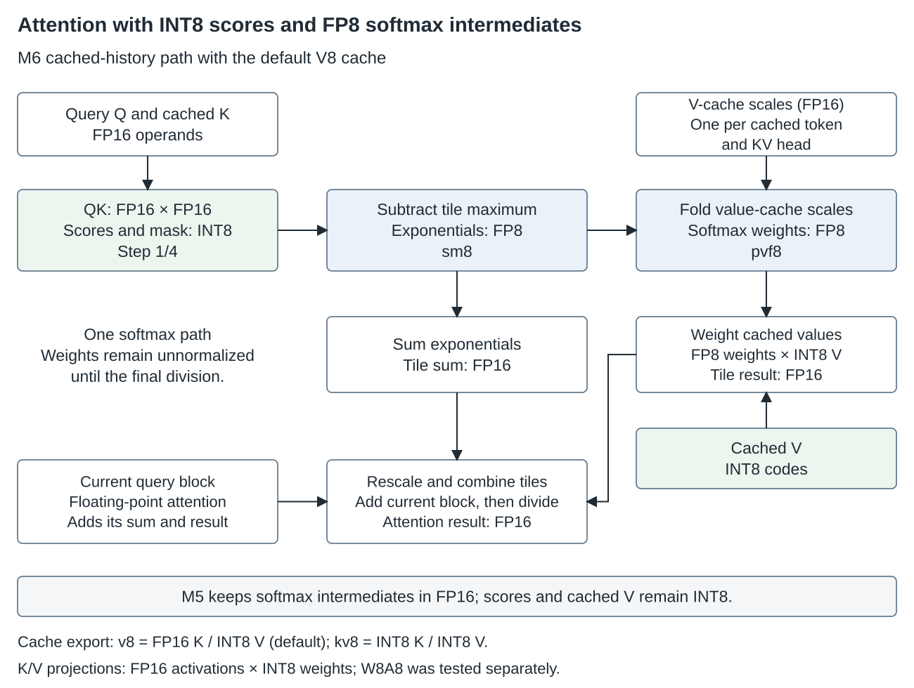

# Quantization of ANEMLL Forge Qwen3.8-27B

ANEMLL Forge is an independent research project that adapts **[Qwen/Qwen3.8-27B](https://huggingface.co/Qwen/Qwen3.8-27B)**, developed by the Qwen Team, for the **M6 Apple Neural Engine through Core AI**. The first release's target is `mix25in_mixr_lr64mix`. **Release 0.2** stores every MLP matrix as a three-bit vector LUT, adds online Hadamard rotations to the token mixers, and fits the weights with [GPTQ plus quantization-aware training (QAT)](#gptq-then-quantization-aware-training-qat); see [release 0.2](#release-02-three-bit-mlp-and-token-mixer-rotations). This guide explains both the basic idea and the implementation so others can learn from the choices, experiments and limitations.

The source checkpoint is pinned to [`1d4bf0f2ff6012fd82039f2fa52739d0dd7c60c0`](https://huggingface.co/Qwen/Qwen3.8-27B/tree/1d4bf0f2ff6012fd82039f2fa52739d0dd7c60c0). Credit for the original model belongs to the Qwen Team; its weights carry **Copyright 2026 Alibaba Cloud** and the upstream Apache 2.0 license. See [attribution and redistribution requirements](ATTRIBUTION.md). ANEMLL supplies this quantization, conversion and runtime work; no Qwen or Apple endorsement is claimed.

Start with [the basic overview](#basic-overview). Continue to [the detailed implementation](#detailed-implementation) for formats, math and source links, or [reproduction and validation](#reproduction-and-validation) for the workflow. The [historical notebook](../QUANTIZATION_NOTES.md) retains earlier experiments; later findings can supersede earlier recommendations.

**Training source:** the release 0.2 GPTQ, QAT, corpus generator and materializer are now included in this checkout. See the [complete training recipe and source provenance](QUANTIZATION_TRAINING.md). Private calibration sessions and cached evaluation traces are not bundled.

**Evaluation status:** the release model card currently describes **KL divergence evaluation only**. Historical research results below explain design decisions; they are not a new benchmark of the uploaded artifacts. ANE benchmarks will be added when measured with identified artifact revisions, hardware and workloads. The [quality benchmark plan](BENCHMARK_PLAN.md) adds instruction, coding and reasoning tests to complement KL.

## Basic overview

### What quantization changes

A model's **weights** are the learned numbers used by its layers. Quantization represents these numbers with a smaller set of values. We accept some approximation error to reduce their storage and potentially the amount of weight data moved during inference.

The original checkpoint uses BF16 weights. Much of this conversion uses a **lookup table**, or LUT: store a small table of representative values and an index selecting a table entry for each weight or pair of weights. A compiler can pack those indices more tightly than full floating-point weights. This representation is also called **palettization**.

Smaller weights can make a large model more practical to run, but compression is only one part of the problem. More aggressive approximation can change predictions. Rotations and residual corrections add computation, and the compiled programs need scratch space and runtime buffers. The result must preserve useful model behavior and work efficiently in the actual Core AI/ANE graph.

### Weights, activations and the KV cache are different

**Activations** are the temporary values produced while processing tokens. The **KV cache** stores earlier attention keys and values, so later tokens can attend to them. **DeltaNet state** is a separate recurrent state used by the model's linear-attention layers. These are runtime data, not the saved learned weights.

The weight recipe and runtime attention precision are separate. `KV_FMT="INT8 per-channel"` names the **attention K/V projection weights**, with one FP16 scale per output channel. The release 0.2 runtime also uses a [V8 cache](KV_CACHE_V8.md): transposed FP16 keys and signed INT8 values, with one FP16 scale per token and KV head. Accepted value rows are quantized when written to the cache. INT8 scores and M6 FP8 softmax intermediates are a third, independent runtime choice; see [Accelerated attention on the ANE](#accelerated-attention-on-the-ane). DeltaNet state remains floating point.

Consequently, “two-bit model” is an incomplete description. It neither describes every weight nor establishes two-bit activations, an integer multiply-accumulate path, or the model's total RAM requirement.

### The recipe used for this target

This section describes the first release. Release 0.2 changes the MLP to three-bit vector LUTs in every layer and rotates the token mixers' inputs; its allocation is in [release 0.2](#release-02-three-bit-mlp-and-token-mixer-rotations).

The recovered [mixed-bit plan](../configs/quantization/mix25in_mixr.json) and local export headers agree on the following allocation:

- **MLP gate/up/down:** all three matrices use `vector 2x16 + pcs` in 38 layers and `LUT4 per-tensor + pcs` in 26 layers. The vector format has a nominal packed index cost of two bits per weight; LUT4 has four.
- **Token mixers:** layers 0–23 use vector LUTs for their large selected projections; layers 24–63 use scalar LUT4. Full-attention K/V projection weights keep the separate per-channel INT8 quantizer format.
- **Mixer residual correction:** rank-64 FP16 factors are added to the selected DeltaNet and full-attention projection matrices, including the INT8 K/V projections. MLP matrices do not receive these factors in this recipe.
- **Output head:** scalar LUT4 with per-output-channel scaling.
- **Embedding lookup:** a prepared FP16 embedding table, looked up on the host. Small tensors such as norms and recurrent-layer parameters are retained in floating point in conversion.

`pcs` means **per-channel scaling**. GPTQ uses example activations to choose rounding and compensate error. Online Hadamard rotations change the MLP's basis before its linear projections, making low-bit approximation more manageable. The mixed-bit plan spends more storage on matrices where extra precision helps the chosen workload most. The rank-64 branches recover part of the error in mixer weights.

### What a user downloads

For release inference, download the **Core AI target and matching DFlash2 drafter packages**, matching configuration/tokenizer, prepared FP16 embeddings, and drafter configuration/selector codebooks. Original BF16 checkpoint shards and quantized `.safetensors` exports are not required to run this prepared bundle. The original weights and export are needed for rebuilding or doing new quantization experiments. No Core ML model upload is required for this Core AI release. See [download and quick test](HUGGING_FACE.md).

## Detailed implementation

### 1. Model structure and precision allocation

The text model has 64 layers: 48 Gated DeltaNet layers and 16 full-attention layers, with full attention at layers 3, 7, …, 63. Hidden size is 5,120 and MLP intermediate size is 17,408. The checkpoint's `qwen3_5` architecture name appears in source; it does not change the pinned upstream model identity.

The MLP comprises **gate**, **up** and **down** projections. The gate and up branches produce the gated intermediate activation; down maps it back to hidden size. Token mixers propagate information between tokens: DeltaNet uses recurrent state, while full attention uses the K/V history.

The plan supports **per-matrix** keys such as `23.gate`, `23.up`, `23.down` and `0.mixer`. Although independent MLP formats are supported, this particular plan has a uniform gate/up/down triple in each layer. Its LUT4 MLP layers are:

`23, 24, 25, 27, 28, 30, 32, 35, 36, 37, 39, 40, 41, 42, 44, 45, 49, 51, 53, 54, 55, 58, 60, 61, 62, 63`.

The other 38 layers use vector `2x16`. Twenty-four mixer overrides select vector `2x16` for layers 0–23; the later mixers inherit scalar LUT4 from the quantizer's `MIXER` setting. Full-attention `k_proj` and `v_proj` use `KV_FMT` independently of that mixer setting. The DeltaNet combined `in_proj_qkv` is a different projection and follows the mixer's LUT format. See [`quantize_mixer`](../scripts/qwen38_gptq_27b.py).

### 2. Exactly what “vector 2x16 + pcs” means

For a matrix of shape `(Cout, Cin)`, **2** is the length of each codebook vector and **16** is the number of codebook vectors. A single four-bit index selects one of 16 learned, two-component centroids. The two components represent **two consecutive output channels at the same input column**. They do not pair two neighboring input columns.

Let `L` be the FP16 codebook of shape `(16, 2)`, `I` the index array of shape `(Cout / 2, Cin)`, and `s` one FP16 scale per output channel. Reconstruction is:

$$\widehat W_{2g+t,j}=s_{2g+t}\,L_{I_{g,j},t},\qquad t\in\{0,1\}.$$

One four-bit index covers two weights, so the **nominal packed index cost** is `4 / 2 = 2` bits per weight. The codebook adds 64 bytes per matrix and the scales add `2 × Cout` bytes. Ignoring padding and package metadata, packed storage is therefore:

$$\frac{C_{out}C_{in}}{4}+64+2C_{out}\quad\text{bytes}.$$

As an illustrative example, if `L[3] = [-0.25, 0.50]` and the two row scales are `[2, 4]`, index `3` reconstructs weights `[-0.5, 2.0]` at that input column. These are example numbers, not model weights.

**The intermediate export is not bit-packed.** [`encode`](../scripts/qwen3_lut_common.py) stores indices as `uint8` in `.safetensors`: one byte per pair, or four bits per original weight for the index payload. Low-bit packing is a later conversion/compiler representation. Export-file bytes must not be presented as the two-bit packed weight footprint.

Scalar `LUT4 per-tensor + pcs` instead has 16 one-component FP16 centroids and one four-bit packed index per weight. Its table occupies 32 bytes, with the same per-row scale overhead. The intermediate `.safetensors` index tensor also uses `uint8`, one byte per weight. “Per-tensor” means one shared codebook for that matrix, not one codebook for the whole model.

Apple's [palettization overview](https://apple.github.io/coremltools/docs-guides/source/opt-palettization-overview.html) describes scalar/vector centroids and per-channel scaling. Our exact layout and fitting choices are defined by [`FORMATS`, `make_rounder` and `encode`](../scripts/qwen3_lut_common.py), rather than an arbitrary uniform INT2 scheme.

### 3. Per-output-channel scaling and learned centroids

Each output row receives a scale computed from its RMS weight magnitude:

$$s_o=\sqrt{\operatorname{mean}_j W_{o,j}^2}.$$

The implementation rounds this scale through FP16, replaces zero RMS scales with one, and fits/rounds the normalized matrix `W / s`. Reconstruction multiplies each output row by its scale. This allows rows with different magnitudes to share a useful codebook.

Vector centroids are fitted with k-means, using at most 300,000 sampled vectors per matrix, three initializations and a maximum of 200 iterations by default. `KMEANS_SEED` selects the sampling and initialization seed; `KMEANS_THREADS=1` limits parallel reductions. `KMEANS_SAMPLE` and `KMEANS_INIT` expose the sample/restart controls. Scalar centroids use 40 weighted one-dimensional Lloyd updates on at most 65,536 sampled values per table. Centroids are rounded to values exactly representable in FP16 before rounding the weights.

`AW=1` supplies **activation-energy weights** from the diagonal of the calibration Hessian to codebook fitting. It makes errors in frequently active input directions count more during centroid fitting. This switch is distinct from both GPTQ error feedback and activation-weighted residual-factor fitting. It is not a claim that the export implements every algorithm commonly called AWQ.

Per-channel scaling is retained in all 192 release 0.2 MLP matrices, the selected DeltaNet and attention LUT projections, the INT8 attention K/V projection weights, and the LUT4 LM head. During QAT, indices and INT8 codes remain fixed. LUT values and output-row scales train; scales are represented as their GPTQ value times `exp(log_s)`. The head has its own table/scale optimizer group. Mixer correction factors train separately and remain floating point, as do embeddings, norms, the small DeltaNet projections and convolution weights. These weight scales are distinct from the separate input-channel rescaling experiments and from KV-cache scales. The INT8 rounder now keeps the FP16 scale positive even for zero or extremely small rows; this edge-case fix is recorded separately from the recovered research source.

The historical probes found little benefit from adding many scalar codebooks to these tested normalized matrices. Additional grouping also changed observed timing, and per-group vector LUTs lost ANE placement in the tested paths. Those findings motivated the shared codebook plus row scales; they are observations for the recorded shapes/toolchains, not universal hardware restrictions. See [techniques and limitations](TECHNIQUES.md) and the [original vector-LUT investigation](history/VECTOR_LUT_README.md).

### 4. GPTQ: minimize useful output error

Round-to-nearest selects the closest representable weights. **GPTQ** also uses calibration activations to compensate for error introduced while quantizing columns. Its basis is the [original GPTQ paper](https://arxiv.org/abs/2210.17323); this repository adapts the rounder to its LUT formats.

For row-wise activation samples `X` and weights `W`, the local objective is approximately:

$$\min_Q\frac{1}{N}\left\|X(W-Q)^T\right\|_F^2,\qquad H=\frac{X^TX}{N}.$$

Here `Q` must be representable by the chosen LUT/scale or INT8 format. The objective weights errors by the actual input distribution, rather than treating every weight difference as equally harmful.

The implementation orders input columns by descending `diag(H)`, adds diagonal damping equal to 1% of the mean Hessian diagonal, and processes columns in blocks of 128. It uses FP64 Hessian factorization (cuSOLVER on the selected CUDA device, the CPU helper for CPU/MPS runs) and propagates each column's rounding error into columns not yet quantized. Its vector groups stay within one input column, so the column-wise feedback can use the same structure as a scalar rounder. See [`gptq`](../scripts/qwen3_lut_common.py).

Calibration is **true sequential**. MLP gate/up are quantized first; down's Hessian is formed from the resulting gated activation after gate/up quantization. Mixer input projections are quantized before recapturing the output projection's input. Later layers receive outputs propagated through already-quantized earlier layers. This helps calibration reflect the model it is actually building. It does not eliminate quantization error or guarantee generalization to different prompts.

### 5. Calibration and evaluation must stay separate

The recorded recipe uses 48 rows of 1,024 tokens: 16 WikiText training rows, 16 self-generated chat rows and 16 private coding-agent rows. `CAL_MIX` replaces the last WikiText rows with supplied token arrays. The final calibration batch is excluded from each projection's Hessian fitting and used for local held-out SNR; with the historical `BATCH=4`, that is four rows. Those local checks are separate from whole-model evaluation.

Private agent sessions are **not distributed**. The repository includes a [self-generated calibration helper](../scripts/qwen38_calib_gen.py) and an [explicit session importer](../scripts/qwen38_calib_pi.py). A public replacement calibration set creates a new experiment; it cannot establish exact reproduction of the old export's quality values.

Keep independent token traces for model selection and final reporting. Record the checkpoint/tokenizer revisions, dataset identities, row counts, sequence length, seeds, prompts/template, quantizer settings and split boundaries. Repeatedly choosing a bit plan using one trace can overfit it even if that trace was initially separate from calibration.

### 6. Online Hadamard rotations

The MLP input and its intermediate activation are rotated immediately before the corresponding linear projections. The rotation is a block-diagonal transform with **1,024-wide normalized Hadamard blocks** and seeded random signs. For row-vector inputs, write a block as `M = D H / 32`, where `D` is diagonal with signs ±1. Because `M Mᵀ = I`, rotating input and weight together preserves the unquantized linear map:

$$x'=xM,\quad W'=WM,\quad x'W'^T=xW^T.$$

Spreading a difficult input direction across a block can make low-bit approximation easier. The quantizer works in that rotated basis. Its reference evaluation folds the quantized weight back as `Q Mᵀ`; the ANE graph instead applies the rotation online and uses the exported `Q`.

Seeds are `1000 + layer` for the gate/up input and `2000 + layer` for the down input. The export records the basis, seeds and block width. The transform is applied before gate/up, and separately after the nonlinear gated activation before down; it is not commuted through SiLU. Seeds and placement must agree between conversion and reference evaluation.

The Core AI builder represents each transform as a grouped convolution with exact two-value weights ±1/32. This costs runtime work and additional representation. It does not imply an automatic fast-Hadamard hardware primitive. The [QuaRot paper](https://arxiv.org/abs/2404.00456) is related work on rotation-based quantization; this recipe does not claim QuaRot's complete four-bit activation/KV-cache inference scheme. See [`block_rotation`](../scripts/qwen38_gptq_27b.py) and [`Hadamard`](../coreai/qwen38_coreai_build.py).

### 7. Mixed-bit planning: spend precision where it helps

Layer sensitivity is measured by selectively quantizing matrices or bands while holding the rest of the reference model fixed. Early WikiText allocation and later chat/code allocation produced different priorities. In the later in-domain experiments, many later MLP layers were more sensitive; an early recommendation to aggressively compress late MLPs was superseded for this workload.

[`qwen38_plan_mixr.py`](../scripts/qwen38_plan_mixr.py) trades mixer storage for MLP precision. It estimates the damage from making an eight-layer mixer band vector two-bit and the benefit from upgrading candidate MLP matrices to LUT4. It accepts a trade when estimated MLP benefit exceeds mixer damage within its approximate storage budget. The resulting [recovered plan](../configs/quantization/mix25in_mixr.json) selects early mixer bands 0–23 and the MLP layers listed above.

This is an empirical heuristic. The planner uses historical sensitivity inputs and fitted constants, assumes approximate additivity and ignores small LUT/scale overhead differences. Those estimated gains must be checked with the combined model. Copying the plan preserves its allocation, but changing the model, calibration or workload requires new measurements. The historical commands and acceptance gate are preserved in [`run_mixr.sh`](../pipelines/m3u/run_mixr.sh) and [`run_mixr_final.sh`](../pipelines/m3u/run_mixr_final.sh).

### 8. Rank-64 residual correction

For a mixer weight, let `E = W_reference − W_quantized`. The deployed script approximates the leading rank-64 part of this error and stores FP16 factors `A` and `B`:

$$\widehat W_{corrected}=W_{quantized}+AB,\qquad y=W_{quantized}x+A(Bx).$$

`A` has shape `(Cout, 64)` and `B` has shape `(64, Cin)`. The runtime adds two thin FP16 1×1 convolutions alongside the quantized projection. The factor payload costs `2 × 64 × (Cout + Cin)` bytes per matrix and adds compute, so it is not free compression.

The deployed [`qwen38_lowrank_export.py`](../scripts/qwen38_lowrank_export.py) fits the **unweighted weight error**, using `torch.svd_lowrank(E, q=80, niter=4)` and retaining 64 components. This is a randomized approximate SVD; it is not an exact deterministic decomposition. The script does not currently set a Torch RNG seed. Its split is `A = U[:, :64] * singular_values` and `B = V[:, :64]ᵀ`, rounded to FP16. It is a correction derived from weight error, not a task-trained LoRA adapter.

Header inspection of the local final export found rank-64 FP16 factors for all 208 selected mixer projection matrices. This verifies presence, shapes and dtypes; header inspection alone does not verify tensor bytes or establish lineage of a compiled package.

The historical experiments found stronger benefit from these factors on DeltaNet projections than on two-bit MLP weights. Adding MLP factors cost additional storage/latency for a relatively small quality gain and was dropped. [Activation-weighted factor fitting](../scripts/qwen38_lowrank_aw.py), [dynamic rank allocation](../scripts/qwen38_lowrank_dyn.py) and [block reconstruction](../scripts/qwen38_blockrecon.py) remain research alternatives. Their presence in the repo is not evidence they produced this served export.

Block reconstruction keeps indices fixed while adjusting LUT entries/scales, optionally factors, against a reference activation stream. It needs its own held-out selection. Neither it nor the activation-weighted/dynamic factor scripts should silently replace the deployed plain rank-64 recipe when explaining this artifact.

### 9. INT8 projection weights and runtime state

The full-attention K/V weight rounder uses symmetric per-output-channel scaling, approximately `s = max(abs(W)) / 127`, and codes obtained by rounding/clipping `W / s` to `[-127, 127]`. The export stores signed eight-bit codes and FP16 row scales. The residual factors above can correct these projections too.

The default Core AI builder preserves these codes as **compile-time INT8 weights**, together with their FP16 channel scales. [`QConv`](../coreai/qwen38_coreai_build.py) passes them through `constexpr_blockwise_shift_scale`; only the compatibility option `QCONV_INT8=0` expands them to FP16. The [M6 compiled-program inspection](research/M6_COMPUTE_ACCELERATION_2026-10-03.md) reports INT8 projection kernels without an FP16 weight copy: 40 MB instead of 50 MB per attention layer, and 152 instead of 272 static cycles for a 64-row projection task. Those are local program measurements, not a whole-model speedup. GPTQ fits the approximation in this format; the compiler provides the accelerated inference path.

The Core AI [runtime](../scripts/qwen38_coreai_model.py) supports cache formats declared by the selected package. Release 0.2 uses FP16 keys and INT8 historical values; [cache management](../scripts/qwen38_kv_cache.py) quantizes accepted values with per-token/head scales. FP16-only packages retain FP16 history. DeltaNet state is separate and floating point. Cache memory grows with context even though the model weights stay fixed.

### 10. From quantizer export to Core AI execution

The offline export contains LUTs, byte-sized index tensors, scales, rotation metadata and optional factors. A reference path reconstructs effective weights to evaluate quantization separately from compiler effects.

The Core AI [builder](../coreai/qwen38_coreai_build.py) uses floating-point reference operations with explicit quantization boundaries, preserves INT8 projection constants by default, and registers exact exported LUTs/indices for palettization rather than fitting replacement codebooks. For LUT branches, per-channel scale is applied after the convolution. Palettization runs before `optimize()` because folding that multiply into weights would destroy the intended shared codebook structure. The local compression hook uses the known codebook/vector axis; the compiler produces the runtime representation.

This means the host inference loop does not unpack every LUT weight on every token. The compressed representation is part of the model package consumed by the compiler/runtime. It still does not establish the physical lookup circuitry, dequantization placement, accumulator precision, or a universal native two-bit compute path. Placement reports and same-weight tensor comparisons are needed for the graph actually deployed.

The prepared manifest has **16 four-layer chunks plus a head**, with verify/decode width `T=8` and prefill width `T=64`. It advertises context entries 8K, 16K, 24K, 32K, 48K and 64K; the largest KV capacity is 65,472 rows. Entries within a Core AI package are intended to share weights. The intended release includes the matching DFlash2 drafter: seven proposed tokens plus an anchor are verified together. Acceptance determines useful output per cycle; `T=8` does not guarantee eight emitted tokens per call. Target-only decoding remains a diagnostic. See [pairing, acceptance and runtime behavior](SPECULATIVE_DECODING.md).

Core ML conversion code remains an experimental/reference route. Its LUT construction uses `constexpr_lut_to_dense` and scaling operations, but Core ML packages are not part of the planned runtime upload. Core ML graph behavior must not be automatically attributed to Core AI lowering.

### 11. Numerical correctness is separate from quantization quality

A quantized PyTorch model can approximate the source well while the compiled graph introduces a different error. The investigation isolated intermediate tensors with a same-weight reference, rather than relying on fluent text or final cosine alone.

The retained build uses **tanh-form SiLU** in DeltaNet and MLP, mathematically `0.5 × x × (1 + tanh(x / 2))`, and overflow-safe softplus, `relu(x) + log(1 + exp(−abs(x)))`. It scales DeltaNet q by 16 and v by 64, with the corresponding squared scale in normalization epsilon. These choices address numerical problems measured on the tested FP16 path; they are not a different low-bit weight format.

Promising early-layer MLP down-input scaling was later rejected after static and dynamic variants corrupted late-layer outputs. The final manifest records `MLP_DS=1` and no scale table. An algebraically equivalent expression may also be fused into a problematic native operation, so source math alone is insufficient. See [numerical experiments and superseded variants](../ANE_DELTANET_NUMERICS.md) and [session lessons](SESSION_LESSONS.md).

## Accelerated attention on the ANE

The runtime graph adds acceleration beyond GPTQ weight fitting. The [builder](../coreai/qwen38_coreai_build.py), [compiled-program analysis](ANE_HWX_MLIR_ANALYSIS.md), and [dated measurements](research/M6_COMPUTE_ACCELERATION_2026-10-03.md) distinguish the following stages of cached-history attention:

**The default cache quantizes V only.** `--kv-cache-dtype v8` stores K in FP16 and V in INT8; `--kv-cache-dtype kv8` exports a separate graph with both K and V in INT8. Both quantized caches use FP16 scales per token and KV head. The option `--kv-cache-dtype both` instead packages selectable FP16 and V8 layouts; it does not mean INT8 K plus INT8 V. Runtime selection requires matching exported functions. These cache choices are independent of the projection weights: GPTQ's `KV_FMT="INT8 per-channel"` applies to **both** `k_proj` and `v_proj`. See [cache export choices](KV_CACHE_V8.md#cache-export-choices).



The diagram follows one tiled softmax calculation. Exponential weights feed both the normalization sum and the weighted sum of cached values. The value-cache scales are folded into the latter branch, leaving the denominator unchanged. Tile results are rescaled, combined with the floating-point current block, and divided by the combined denominator. The attention gate and output projection follow this result and are omitted here. Dtype labels describe tensor formats, not undocumented internal accumulator precision.

| Stage | M6 | M5 |
| --- | --- | --- |
| Query/key operands | FP16 | FP16 |
| Scores after quantization and masking | INT8, step 1/4 | INT8, step 1/4 |
| Exponentials read by the softmax sum | FP8 E4M3 | FP16 |
| Maximum and sum reduction outputs | FP16 | FP16 |
| Scaled softmax weights used with cached V | FP8 E4M3 | FP16 |
| Stored keys / values | FP16 / INT8 | FP16 / INT8 |
| Attention output | FP16 | FP16 |

On M6, `ATT_INT8MM=s8,s8b,sm8,pvf8` places quantize/dequantize boundaries on scores and **softmax intermediates**. The two FP8 switches mark stages of the same path: `sm8` stores `exp(score − tile_max)` in FP8 before the normalization sum, while `pvf8` stores the value-scale-adjusted softmax weights in FP8 before they multiply the INT8 cached values. These weights are still unnormalized; division happens after the partial results are combined. The boundaries fuse into producer and consumer tasks, so large intermediate tensors cross memory in one-byte formats. The compiled program has no dedicated hardware softmax instruction, and the observed reduction outputs are FP16. Internal accumulator precision is not established by the output format.

The measured product of INT8 values and FP8 softmax weights has the same multiply-add cycle count as its FP16-weight control; reduced traffic supplies the benefit there. Uniform UINT8 softmax weights can multiply faster, but the tested value-scale fold lost about 7% of softmax mass to zero rounding, versus 0.02% for FP8 in the real-text sample. This is why the selected M6 path retains FP8 softmax intermediates.

The M6 FP8 scale is `ATT_PF8_UNIT=1/64`: softmax intermediates bounded to [0, 1] reach FP8 values of at most 64 after scaling. This bound does not mean the weights sum to one. An earlier scale of 1/256 produced incorrect device results for one captured head with values near 200 despite E4M3's larger representable range. The corrected range matched the host simulation in that investigation. The tested M5 ANE compiler rejects FP8, so its functions use `ATT_INT8MM_M5=s8,s8b`: INT8 scores with FP16 softmax intermediates and FP16 softmax weights in the value product. Both variants retain transposed FP16 keys (`KV_KEYS_T=1`). [Release 0.2 M5 validation](VALIDATION_M5_RELEASE_0_2.md) confirms the selected function set and ANE placement.

### Measured FP8 benefits

**Release 0.1 did not use FP8 attention.** The [5 October measurements](research/M6_COMPUTE_ACCELERATION_2026-10-03.md#8-bit-attention-part-by-part) below concern later experimental graphs, preceding the release 0.2 M6 path described above. They test FP8 at different stages of the same softmax path, then the combined model graph. **Latency reductions and throughput increases are different quantities**; the table labels each explicitly. Rows have different controls and their gains must not be added together.

| Change and measured scope | Control | Recorded result on M6 |
| --- | --- | --- |
| Store scaled softmax weights in FP8 before the value product (`pvf8`), one historical `kv8` attention core; denominator path stays FP16 | INT8 cached values × FP16 softmax weights | Prefill latency: 7.55 → 6.69–6.74 ms at 32K, **10.7–11.4% lower**; 14.83 → 13.04 ms at 64K, **12.1% lower**. Verify was essentially unchanged. |
| Also store the exponentials read by the softmax sum in FP8 (`sm8`), in the fixed INT8-score core with UINT8 softmax weights (`s8b,pvtu`) | Same core without `sm8` | Prefill latency reduction against the shared FP16 baseline grows from 20.7% to 27.5% at 32K and 21.5% to 28.2% at 64K. This is an **additional 8.6% and 8.5% latency reduction**, respectively, relative to the already optimized control. |
| INT8 scores plus FP8 exponentials and sum, isolated softmax tile | FP16 tile | **22–25% lower prefill latency**, about **15% lower verify latency**. This probe also quantizes centered scores (`s − max`) to INT8; it is not the selected release graph. |
| Later experimental INT8-score and range-corrected FP8 graph (`s8,s8b,sm8,pvf8`, form C2), full target without drafter | Same-weight, non-FP8 V8 graph, before transposed keys | Prefill throughput: **292.5 → 310.8 tokens/s at 8K (+6.3%)** and **199.6 → 223.9 at 64K (+12.2%)**. |

The first three rows are historical research probes, not interchangeable full-model benchmarks. The `kv8` cores stored both keys and values in INT8; release 0.2 uses FP16 keys and INT8 values. The incremental `sm8` result isolates the benefit of FP8 exponentials and summation **within the UINT8-PV research variant**, whose probability rounding was subsequently rejected for the selected M6 path. The increment is calculated from the reported common-baseline timings, for example `1 − (1 − 0.275) / (1 − 0.207) = 8.6%`; it is not a 27.5% FP8-only speedup. See [8-bit softmax](research/M6_COMPUTE_ACCELERATION_2026-10-03.md#8-bit-softmax) for the tile and core controls.

The full-target experiment reused the earlier weights while changing the runtime graph; its FP8 candidate was **not the released 0.1 runtime**. Its 64K direct KL to the non-FP8 V8 control was 0.00048. It measures the combined attention changes, not FP8 alone, and is neither a release-to-release comparison nor a new release 0.2 measurement. The earlier DeltaNet/tile-size gains and the later transposed-key gains are separate experiments and must not be attributed to FP8. See [range-corrected C2](research/M6_COMPUTE_ACCELERATION_2026-10-03.md#form-c-at-long-context-the-fp8-range-fault-and-c2) and [transposed keys](research/M6_COMPUTE_ACCELERATION_2026-10-03.md#transposed-key-cache-c2t).

### Measured INT8 compute and its limits

Quantizing **both weights and activations** (W8A8) can engage the ANE's faster INT8 × INT8 compute path. [Apple documents this for M4-class hardware](https://apple.github.io/coremltools/docs-guides/source/opt-quantization-perf.html); the measurements below directly confirm it on M6. The recorded results do not constitute a matched M4/M5/M6 comparison or establish an exact twofold speedup for every shape and scale layout.

The graph can still contain `quantize → dequantize` pairs around apparently floating-point operations. With supported constant scales and zero-point-zero forms, the compiler folds those boundaries into producer and consumer tasks: the producer writes INT8 and the multiply-add reads INT8 directly. The [HWX signatures](ANE_HWX_MLIR_ANALYSIS.md#4-8-bit-rules-int8-uint8-fp8-and-their-hwx-signatures) establish execution formats; a `dequantize` in source code alone does not imply a separate FP16 conversion at runtime. Offset and runtime-scale variants can prevent this fusion.

The [INT8 compute probe](research/M6_COMPUTE_ACCELERATION_2026-10-03.md#int8-compute-on-the-ane) confirms that the M6 ANE executes **INT8 × INT8** for both constant weights and runtime operands. With dense 4,096 × 4,096 convolutions and 1,024 rows per call, it recorded:

| Operand format | Measured throughput | Relative to FP16 |
| --- | ---: | ---: |
| FP16 weights and activations | 18.6 TOPS | 1.00× |
| INT8 weights and activations (W8A8), per-channel weight scales | 38.4 TOPS | **2.06×** |
| W8A8, shared weight scale | 52.8 TOPS | **2.84×** |

These are isolated arithmetic-throughput measurements, not LLM tokens/s. A runtime INT8 × INT8 matmul reached 53.2 TOPS in the same investigation. GPTQ's exported INT8 K/V weights alone do **not** make the projection W8A8: the default `QConv` preserves INT8 weights but does not insert INT8 activation quantization. The separate projection evidence above (272 → 152 static cycles and 50 → 40 MB) concerns that weight-format change, not a measured 2.84× layer speedup.

The [real-layer tests](research/M6_COMPUTE_ACCELERATION_2026-10-03.md#8-bit-attention-part-by-part) show why scope matters. Adding W8A8 K/V projections changed layer-3 prefill from 2.510 to 2.448 ms at 8K, but only 15.075 to 15.061 ms at 64K. Multiplying INT8 cached values by UINT8 softmax weights cut layer prefill by 6.3% at 8K and 9.4% at 64K, but its rounding error motivated the selected FP8 path. INT8 QK with per-row rescaling made prefill slower. The deployed M6 path therefore combines INT8 projection weights, FP16 query/key operands, INT8 scores, and FP8 softmax weights used with INT8 cached values; it does not use INT8 × INT8 throughout attention.

The [recorded C2 HWX excerpt](ANE_HWX_MLIR_ANALYSIS.md#5-attention-what-the-program-looks-like) makes the distinction concrete: QK has `in=float16`, `kern=fp16`, `out=int8`; the cached-value product has `in=int8`, `kern=e4m3`, `out=float16`. An INT8 **score output** does not make QK an INT8 × INT8 operation. Likewise, exporting an INT8 key cache with `kv8` does not by itself quantize the queries. W8A8 projections and INT8-query research variants were tested separately from the selected release graph.

## DFlash2 and verifier optimizations

Release inference pairs the quantized target with a matching DFlash2 drafter. Several graph and runtime optimizations make this practical beyond the weight formats and accelerated attention above. The [speculative-decoding guide](SPECULATIVE_DECODING.md) describes acceptance and package pairing; the measurements below are historical M6 experiments, not a new benchmark of release 0.2.

### Exact block solve for Gated DeltaNet

An eight-row verifier processes an anchor plus seven draft tokens. Within each Gated DeltaNet block, later rows depend on earlier rows. The chunkwise formulation resolves this through a small triangular system `(I + N) X = rhs`. Because `N` is strictly lower triangular and has eight rows, `N^8 = 0`, giving the exact finite product:

$$ (I + N)^{-1} = (I - N)(I + N^2)(I + N^4). $$

The [`GDN_FAST=1` implementation](../coreai/qwen38_coreai_build.py) replaces seven serial row updates with this product and a multiplication by the right-hand side. This is an implementation of the established chunkwise delta-rule formulation and its finite path sum, explained by [Songlin Yang](https://sustcsonglin.github.io/blog/2024/deltanet-2/). The ANE-specific choice is to express the small products as **broadcast multiply plus reduction**: a direct chain of computed matrix multiplications failed ANE compilation in the recorded experiment. The same switch uses native depthwise convolution and combines two state products into one during each eight-row prefill sub-block. It is enabled by default in the current builder.

The [three-core microbenchmark](research/M6_COMPUTE_ACCELERATION_2026-10-03.md#gated-deltanet-core-measured), excluding input/output projections, recorded:

| Gated DeltaNet implementation | Eight-row verification | 64-row prefill |
| --- | ---: | ---: |
| Earlier row-by-row solve | 1.18 ms | 6.82 ms |
| Final `GDN_FAST` combination | 0.64–0.69 ms | 3.42–3.49 ms |

The variants matched the FP32 host reference within a maximum relative difference of `3e-7`; recorded device output error was unchanged at the reported precision. Algebraic equivalence does not imply bit-identical floating-point execution. A one-token recurrent step has no block solve, so this particular benefit applies to blocked verification and prefill.

### Eight-row verification with deferred state commit

The target keeps the current block's recurrent updates pending until acceptance is known. [`commit_pending`](../coreai/qwen38_coreai_build.py) applies only the accepted prefix on the next target call, while the [runtime's `accept(k)`](../scripts/qwen38_coreai_model.py) appends only accepted K/V rows. Rejected proposals therefore do not advance the target's committed state. The runtime also reuses Swift binding plans and persistent buffers across calls at the same context entry.

Full attention uses different history-tile widths for these workloads: `ATT_BLOCK=2048` for verification and `ATT_BLOCK_PREFILL=4096` for prefill by default. The [tile-size measurements](research/M6_COMPUTE_ACCELERATION_2026-10-03.md#attention-history-tiles-measured) motivated smaller tiles than the earlier 16K setting; more tiles also increase cold compilation work. These controls change the compiled graph, rather than the quantized weights.

The [verifier-width experiment](verifier_len.md) explains the eight-row choice. At 64K, measured full-target calls took 131.5 ms for eight rows, 127.2 ms for four and 123.1 ms for three. Shortening the block saved little while reducing the number of drafts that could be accepted. Applying the recorded acceptance distribution to those timings predicted **21–36% lower throughput** for the shorter blocks on the coding-agent workload. These percentages are an acceptance-based model with fixed non-verifier overhead, **not end-to-end server measurements of shorter verifiers**. Package entry sets also differed. Eight evaluated rows still do not guarantee eight emitted tokens.

### Fused drafting and selective prompt ingestion

The [Core AI drafter](../coreai/dflash2_coreai_build.py) combines up to eight newly committed target-feature rows with the next eight-row draft block in one call. Its `draft` and 64-row context-update entries share weights. The host owns the 2,048-slot K/V ring and writes returned rows after the call; putting those state writes inside the graph caused GPU placement in the recorded conversion.

During prompt prefill, [`DraftIngestWindows`](../scripts/qwen38_server.py) sends the drafter only the last `W + R = 2,056` feature rows before each cached-prefix snapshot boundary and the prompt end. Earlier drafter rows would be overwritten before a draft or snapshot could use them, since each context row's K/V depends only on that row's target features. This avoids unnecessary feature copies and context-update calls while preserving the ring and pending rows needed at those boundaries. **The target still processes the entire prompt.** `DRAFT_INGEST=all` retains the full-ingestion comparison path.

### Quantized drafter and matching output head

The drafter's LUT4 policy uses GPTQ-fitted scalar tables with per-output-channel scaling for its large projections, INT8 per-channel weights for the small convolution-kernel projections, and an FP16 selector projection; see the [format policy](../scripts/dflash2_ane_drafter.py). The [runtime](../scripts/dflash2_coreai_drafter.py) evaluates the full target vocabulary head, then uses the upstream rank-256 chain selector over the top 16 candidates per draft position. Candidate filtering reduces host selection work; it does not remove the full vocabulary head from the graph.

After target QAT, rebuild the drafter with that target export's `lm_head.safetensors` through `HEAD_EXPORT`. A stale head can reduce acceptance and invalidate a pairing comparison. The current selector proposes a deterministic path; sampling proposals from a richer drafter distribution, multi-branch verification and relaxed acceptance remain [research proposals](research/DFLASH2_SAMPLING_PLAN.md), not release optimizations.

## GPTQ, then quantization-aware training (QAT)

This is how release 0.2's weights are fitted. GPTQ is the post-training quantization step: it chooses every index, lookup table, scale and low-rank factor from calibration data in one pass. QAT then trains the continuous parameters with gradients, here by distillation: the loss is the KL divergence from the BF16 model's next-token distribution. The method was developed on the first release's formats (vector 2x16 and LUT4 codes, per-channel scales, online MLP rotations, INT8 K / V projections, rank-64 mixer factors, LUT4 head); the models in the table below (`q07`, `n1`, `u48`) keep those formats, and release 0.2 applies the same flow to its own formats ([next section](#release-02-three-bit-mlp-and-token-mixer-rotations)). What changes against the first release is how the numbers are fitted: GPTQ with the low-rank factors inside the sequential pass and more calibration data, then a distillation stage that trains every continuous parameter of the export against the BF16 model while the GPTQ indices stay frozen. The run's engineering log (`QUANT_LOG_2026-10-07.md`, kept with the research data) records every experiment with paired confidence intervals.

The scripts below are included in this repository. They were recovered from a committed `quant-kl-research` snapshot together with the matching evaluator changes. The [training guide](QUANTIZATION_TRAINING.md) records provenance, dependencies, a complete command sequence, and the remaining reproduction limits. The settings below describe the historical runs; source recovery does not prove an exact replay of those runs.

### The flow

1. **Calibration rows** (1,024 tokens each): BF16 chat traces with thinking, rendered agentic coding sessions, WikiText.
2. **GPTQ** with the factors inside the sequential pass ([`qwen38_gptq_27b.py`](../scripts/qwen38_gptq_27b.py)) -> an export: indices, lookup tables, scales, factors, head.
3. **QAT corpus:** BF16 answers, thinking included, to 527 new prompts (637 training rows) ([`qwen38_corpus_gen.py`](../scripts/qwen38_corpus_gen.py)).
4. **Teacher cache:** the BF16 model's top-256 next-token log-probabilities plus a tail bucket for every training position ([`qwen38_qat_kl.py teacher`](../scripts/qwen38_qat_kl.py)).
5. **QAT** (distillation to BF16) with frozen indices ([`qwen38_qat_kl.py train`](../scripts/qwen38_qat_kl.py)) -> an overlay export, best step chosen on a separate selection set.
6. **Materialize** the overlay into a full export ([`qwen38_overlay_materialize.py`](../scripts/qwen38_overlay_materialize.py)), the same 129-file layout as the first release.
7. **Convert, compile and gate on the ANE** exactly as the first release ([EXPORT.md](https://huggingface.co/anemll/anemll-quantized-qwen3.8-27b-for-CoreAI/blob/main/EXPORT.md), [`m6_kl512_eval.py`](../scripts/m6_kl512_eval.py), [`m6_long_ctx_eval.py`](../scripts/m6_long_ctx_eval.py)).

### 1. Calibration rows

| Rows | Script | How they are made |
| --- | --- | --- |
| `calib_chat_ids.npy` (36) | [`qwen38_calib_gen.py`](../scripts/qwen38_calib_gen.py) | BF16 answers, thinking on, sampled like the evaluation traces (T 0.6, top-p 0.95, top-k 20), to the coding and agentic prompts listed in the script, some with tool schemas in the chat template; none is an evaluation prompt |
| `calib_pi_ids.npy` (48) | [`qwen38_calib_pi.py`](../scripts/qwen38_calib_pi.py) | agentic coding sessions rendered through the Qwen3.8 chat template the way the server renders them (tool schemas, thinking, tool calls, tool results cut at 6,000 characters), cut into rows round-robin across sessions; these rows come from the developer's own sessions and are not published |
| WikiText-2 (44) | built in | 1,024-token rows of the WikiText-2 training text |

### 2. GPTQ with the factors inside

```sh
MODEL=<Qwen3.8-27B> WIKI=<wikitext> PLAN=configs/quantization/mix25in_mixr.json \
MIXER="LUT4 per-tensor + pcs" KV_FMT="INT8 per-channel" HEAD="LUT4 per-tensor + pcs" AW=1 BASELINE=0 \
LR_RANK=64 LR_PARTS=gdn,attn NCAL=128 \
CAL_MIX="<data>/calib_chat_ids.npy:36,<data>/calib_pi_ids.npy:48" \
  python scripts/qwen38_gptq_27b.py
```

- `LR_RANK=64` fits rank-64 factors of each mixer projection's remaining error *inside* the sequential pass (LoftQ-style): GPTQ quantizes `W - a b`, and the calibration stream continues through `Q + a b`, which is what the ANE computes. The first release added the factors after the whole pass ([`qwen38_lowrank_export.py`](../scripts/qwen38_lowrank_export.py)).
- `NCAL=128` takes 44 WikiText rows plus the `CAL_MIX` rows (36 chat, 48 agentic), against 48 rows in the first release.
- `AW=1` weights the codebook k-means by `diag(H)`; `PLAN` keeps the first release's allocation (the `u48` variant moves MLP layers 48, 50, 52, 56, 57 and 59 to LUT4).
- CUDA GPTQ is not bit-for-bit repeatable (the 2x16 k-means lands in different optima, about 4% of KL run to run), so every QAT experiment is compared with a control trained on the same GPTQ indices.

### 3. The QAT corpus

```sh
# Use the checked 527-prompt release list committed below.
# Optional: regenerate the 560 unfiltered candidates in a separate file.
# python configs/kl/qat_corpus_build_prompts.py --output /path/to/new/candidates.json
MODEL=<Qwen3.8-27B> CORPUS_PROMPTS=configs/kl/qat_corpus_prompts.json CAL_OUT=<data>/corpus_ids.npy \
  python scripts/qwen38_corpus_gen.py
```

- **Prompts:** the checked release list contains 527 entries selected from 560 seed-7 candidates: **141 code, 130 tool-use, 126 multilingual, 50 math/reasoning and 80 rare-token entries**. Math is 9.5% of this list. The builder's stated 30/20/20/15/15 mix is a design target, not the measured composition of either file. It generates candidates only and does not repeat the historical filtering, which removed 30 math and three code entries. Both files contain repeated prompt strings: 548 distinct strings in the candidate pool and 515 in the release list. The prompts target rare tokens, non-ASCII text and long thinking.
- **Generation:** BF16, thinking on, T 0.6 / top-p 0.95 / top-k 20, up to 1,792 new tokens; sequences packed into 1,024-token rows; 5% of the *sequences* held out as validation rows, so no validation row shares a sequence with a training row.
- **Contamination checks:** historical filtering reports removing 33 candidate entries for word 8-gram overlap with evaluation prompts or near-duplicates (527 kept; 673 rows, 637 for training). The recovered list contains 515 distinct prompt strings, so this was not exhaustive deduplication; sequence-level splitting does not guarantee prompt-level uniqueness across splits. After training, token 13-grams of the packed rows cover 0.04 to 0.12% of evaluation windows (template tokens excluded), all generic phrasing, against a baseline from the original rows; per-sequence gains do not track overlap (Pearson about 0.1), and the gain on the held-out trace matches the development trace.
- A second batch (`corpus2`, 643 more prompts, generated with the FP8-weight model on an A100) gave only 2 to 3% more, so data volume shows diminishing returns past the first batch.

### 4 and 5. Teacher cache and QAT

```sh
MODEL=<Qwen3.8-27B> TRAIN="<data>/corpus_ids.npy:meta,<data>/calib_pi_ids.npy:44,<data>/calib_chat_ids.npy:32" \
WIKI=<wikitext> WIKI_ROWS=44 HOLD=4 TEACHER=<data>/qat_teacher python scripts/qwen38_qat_kl.py teacher

MODEL=<Qwen3.8-27B> EXPORT_DIR=<GPTQ export> OUT_DIR=<new overlay export> TEACHER=<data>/qat_teacher \
TRAIN=<as above> WIKI_ROWS=44 HOLD=4 SEL_TRACE=<data>/kl_dev2 DEV_TRACE=<data>/kl DEV_SEQ=32 \
TRAIN_PARTS=lut,scale,head,lr STEPS=600 BS=2 EVAL_EVERY=50 python scripts/qwen38_qat_kl.py train
```

- **Model:** every quantized linear layer becomes a `QLinear` that rebuilds its weight on each forward pass from the frozen `uint8` indices, the trainable lookup table and the trainable per-channel scale (a log-multiplier on the GPTQ scale), applies the online Hadamard rotation for MLP matrices, and adds `a (b x)` for the trainable factors. The original dense weights of the replaced projections are discarded before moving the student to the GPU; unquantized model components remain floating point. Decoder layers use gradient checkpointing; flash-linear-attention provides the Gated DeltaNet backward pass (CUDA).
- **Trained parameters** (`TRAIN_PARTS=lut,scale,head,lr`, about 162M): lookup-table values (learning rate 2e-4), per-channel scales (2e-4), the rank-64 mixer factors (2e-5) and the LM head's table and scales (1e-4). Indices never change, so size and format stay identical.
- **Loss:** KL(BF16 || quantized) per position over the teacher's top-256 tokens plus one tail bucket, computed in FP32 from BF16-autocast logits; mean over positions. The historical teacher cache stores log-probabilities in FP16, so this is an approximate cached target. The included trainer also offers `TEACHER_DTYPE=fp32` for new caches; FP16 remains the historical default. This is the training/KL-256 protocol; compiled KL-512 uses a different top-K value.
- **Optimizer:** Adam, 20-step linear warm-up, cosine to zero, gradient-norm clip 1.0, 2 rows of 1,024 tokens per step, 600 steps (about 2 hours on one RTX PRO 6000 G4).
- **Selection:** every 50 steps the KL on `kl_dev2`, 128 held-out prompts whose BF16 reference is cached once (`SEL_TRACE`), picks the best step. The teacher command above holds out **16 rows**: four each from the corpus, Pi, chat and WikiText sources. This hold-out is logged as a monitor only; earlier hold-out monitoring mis-ranked runs, and the development trace (`DEV_TRACE`) must not choose its own winner.
- **Check:** `qwen38_qat_kl.py check` compares `QLinear` weights with the evaluator's dequantization and the step-0 KL with the GPTQ export (within about 0.2% on both training machines).

### 6. Materialize and convert

```sh
python scripts/qwen38_overlay_materialize.py <overlay export> <full export>
```

The overlay export links the GPTQ files and adds `overlay.qat` with the trained tensors; materializing writes self-contained files in the first release's 129-file layout. The Core AI build is then the first release's command with `EXPORT_DIR` pointed at the new export; the drafter must be rebuilt with the new export's LM head (`HEAD_EXPORT`), since it drafts with the target's head.

### What each step measured

KL to BF16 on the development trace with the shared 45-token system prompt excluded (64 chats, PyTorch on M3 Ultra), held-out trace in parentheses:

| Model | What changed | KL | Change |
| --- | --- | ---: | ---: |
| First release | GPTQ, factors after the pass, 48 calibration rows | 0.1512 (0.1617) | |
| GPTQ base `c09` | factors inside GPTQ, 128 calibration rows | 0.1269 (0.1341) | -16% |
| `q07` | 300 QAT steps on the 120 calibration rows | 0.1058 (0.1110) | -17% |
| `n1` | 600 steps, plus the 637-row corpus | 0.0897 (0.0930) | -15% |
| `u48` | as `n1`, with six more MLP layers at LUT4 (+0.37 GiB) | 0.0730 (0.0779) | -19% |

Controls separate the causes: of `n1`'s 15%, about 5 points come from 600 steps instead of 300 and about 12 from the new data. Compiled on the M6, the ANE reproduces the PyTorch KL within 0.0004 (KL-512: `q07` 0.0998, `n1` 0.0858, the first release 0.1838), so QAT needs no ANE-specific handling.

Not adopted, each against a matched control: extra loss weight on the worst positions (+1%) or their CVaR (+9%); moving MLP bits between layers at the same total size (no gain after QAT); training the RMSNorm weights (under 1%); refreshing the GPTQ indices with the trained codebooks (about 2% before the new data, none after); long agentic rows (1% worse on short contexts; their long-context gain came from shared session content).

About 85% of the remaining KL sits in the MLP, mostly the two-bit layers, where QAT can only move one 32-value table and one scale per row per matrix. Bytes in the late MLP layers are therefore the strongest remaining lever, which `u48` and the larger `u15` experiment (all 15 late two-bit MLP layers at LUT4) measure. `u15` reached KL 0.0521, but its compiled packages need 15.0 GB of ANE memory against the first release's 13.3 GB, too much for 64K contexts on a 32 GB M6. Release 0.2 spends the MLP bytes differently.

## Release 0.2: three-bit MLP and token-mixer rotations

Release 0.2 (`release_vq3pA_mixh_s600_k1`) changes two things against the formats above and is fitted with the GPTQ and QAT flow of the previous section (600 QAT steps):

| Part | First release | Release 0.2 |
| --- | --- | --- |
| MLP gate / up / down | `vector 2x16 + pcs` in 38 layers, `LUT4 per-tensor + pcs` in 26 | **`vector 2x64 + pcs` in all 64 layers** (three bits per weight) |
| Token mixers | layers 0–23 `vector 2x16 + pcs`, 24–63 LUT4, K / V INT8, rank-64 factors | same formats, **plus online Hadamard rotations** on the projections' inputs |
| LM head, embedding | LUT4 head, FP16 host embedding | unchanged |
| Quantized weights (excluding the embedding) | 9.07 GiB (9.36 with the factors) | 9.44 GiB (9.74), 3.17 bits per weight over 25.6 B weights |
| Plan | [`mix25in_mixr.json`](../configs/quantization/mix25in_mixr.json) | [`mix25in_vq3pA.json`](../configs/quantization/mix25in_vq3pA.json) |

### `vector 2x64 + pcs`

The same layout as [`vector 2x16 + pcs`](#2-exactly-what-vector-2x16--pcs-means) with 64 centroids instead of 16: a six-bit index selects one of 64 learned two-component centroids, the components being two consecutive output channels at the same input column, so one index covers two weights at **three bits per weight**. Packed storage is `3 × Cout × Cin / 8` bytes plus a 256-byte codebook and `2 × Cout` bytes of scales. The exported `.safetensors` keep one `uint8` per pair (four bits per weight in the file), as for 2x16.

On the ANE the table holds 128 values (64 entries of 2), within the 256-value limit of [vector LUTs](history/VECTOR_LUT_README.md). The Core AI builder packs each exported LUT with its own index width (four bits for 16 entries, six for 64). Measured on the M6, a 2x64 MLP compiles to exactly three bits per weight: a four-layer chunk's compiled program grows by 133.8 MB against 2x16, one bit for its 1.07 B MLP weights. An earlier micro-benchmark had found six-bit indices padded to eight bits; with FP16 LUT values and the current compiler they are not.

### Why three bits in every MLP matrix

Three measurements decided the allocation:

- **Error per format.** GPTQ on the MLP matrices of eight layers (1, 3, 10, 21, 31, 40, 57, 63), scored by Hessian-weighted output error: 2x64 closes **80.8%** of the gap between 2x16 and LUT4, between 80.3% and 82.8% for all 24 matrices, with no difference between gate, up and down or between early and late layers. In units of a matrix's 2x16 error, 2x16 leaves 1.00, 2x64 0.24 and LUT4 0.08. Rank-64 factors on the MLP reduce the error by only 2.8% at three bits and 3.3% at two, so they are not used.
- **Cost on the ANE**, M6, four-layer chunk, 8K verify (decode) entry, MLP format changed alone: against 2x16, each 2x64 layer adds 0.145 ms and each LUT4 layer 0.365 ms; prefill is unchanged within 1%. A LUT4 `down_proj` is also compiled twice when a package holds both decode and 64-row prefill functions (44.6 MB more per layer); vector LUTs and LUT4 gate / up are not. On the M5 Max every LUT format decodes at the same speed (2x16, 2x64 and LUT4 within 0.2%).
- **Training.** With the same seed, data and 150 QAT steps, every MLP at 2x64 against `u48`'s allocation at the same size (64 × 3 = 32 × 2 + 32 × 4 bits): KL **-23.0%** [-28.1, -18.6] on the development trace and **-22.7%** [-25.3, -20.1] on the selection trace.

So all-2x64 costs about the first release's MLP decode time (64 × 0.145 ms against 26 × 0.365 ms per step), less ANE memory than the first release, and far less error than any two-bit / four-bit split of the same size. Moving whole MLP layers between two and four bits at a constant size had earlier given no gain after QAT; a per-tensor mix of 2x16, 2x64 and LUT4 is not explored yet.

### Online rotations on the token mixers

The mixers get the same block-diagonal transform as the MLP ([section 6](#6-online-hadamard-rotations)): 1,024-wide Hadamard blocks with seeded signs, applied online.

- **Readers**, seed `3000 + layer`: the input of DeltaNet's `in_proj_qkv` and `in_proj_z` and of attention's `q_proj`, `k_proj` and `v_proj` (5,120 wide). DeltaNet's small `in_proj_a` / `in_proj_b` keep the unrotated input.
- **Writers**, seed `4000 + layer`: the input of `out_proj` and `o_proj` (6,144 wide).
- The export stores each weight as `W M` and records `basis = online`, `block = 1024`, `seed_in` and `seed_out` in `layer_NN_mixer.safetensors`. The rank-64 factors stay in the original basis; the converter moves their `B` into the rotated basis. The residual stream, embedding, LM head and drafter inputs are not rotated.

Measured effect:

- **Error per matrix** (GPTQ, eight layers, three seeds, median over layers): readers -22% to -38%, writers -21% to -28%; MLP unchanged.
- **Training**, 600 steps, two seeds each against matched controls on `u15`'s allocation: KL -9.9% [-13.3, -6.6] on the development trace, -6.4% [-9.4, -3.2] held out, -7.6% [-10.2, -4.8] on a sealed final trace opened only for this comparison, -5.3% on WikiText. On 16K-token windows the change is neutral overall (+2.2%, [-0.3, +5.5]) and -9.7% on sessions with little overlap with the training data.
- **Cost:** per chunk +1.2% decode and up to +1.1% prefill on the M6, +1.9 to 3.3% decode and +1.8% prefill on the M5 Max, and about 0.4 GB more compiled ANE memory for the whole model.

Tried and not adopted, each on the same proxy: folding a random rotation into the residual stream (QuaRot-style R1, zero runtime cost) needs the norm gains folded into the weights, which made the MLP's gate / up error 8% worse (21 to 25% on two-bit layers), more than the rotation recovered; a per-channel scaling diagonal before the rotations (s_j = diag(H)_j^(α/2), α 0.25 or 0.5, absorbable at no runtime cost) was neutral to worse with GPTQ and `AW=1`, except 2 to 5% on the writers at α 0.25, too little to add.

### Results

PyTorch on M3 Ultra, KL to BF16 with the shared system prompt excluded (development trace; held-out trace in parentheses), WikiText KL, and KL on the last 2K tokens of 16K-token windows:

| Model | Size (GiB, with factors) | KL | WikiText KL | 16K windows |
| --- | ---: | ---: | ---: | ---: |
| First release | 9.36 | 0.1512 (0.1617) | | |
| `u48` | 9.74 | 0.0730 (0.0779) | 0.0888 | 0.842 |
| `u15` | 10.30 | 0.0521 (0.0550) | 0.0784 | 0.811 |
| **Release 0.2** | **9.74** | **0.0536 (0.0565)** | **0.0707** | **0.762** |

Against `u48` release 0.2 is 26.6% better on the development trace and 27.5% held out; against `u15`, 2.8% and 2.7% worse, neither significant, and better on WikiText (-9.8%) and the 16K windows (-6.0%; -5.0% [-8.1, -1.7] against the two seeds of the rotation experiment's `u15` controls).

Compiled Core AI packages on the ANE (dual M6 / M5 functions, the same harness as before):

| | First release | **Release 0.2** |
| --- | ---: | ---: |
| KL-512 to BF16, M6 (64 chats, 40,023 positions) | 0.1838 | **0.0518** |
| KL-512 median / p99 | 0.030 / 2.28 | 0.009 / 0.50 |
| Top-1 agreement with BF16 | 86.0% | 91.9% |
| KL-512, M5 Max (M5 functions) | | 0.0517 |
| Perplexity, KL-512 chats (BF16 2.136) | 2.414 | 2.131 |
| Perplexity, verify path (64 + 4,096 tokens) | 6.645 | 6.052 |
| Perplexity, 8K (7,600 + 512) | 8.096 | 7.552 |
| Perplexity, 64K (64,000 + 1,024) | 5.068 | 4.537 |
| Compiled ANE memory, M6 (chunks + head) | 13.32 GB | 12.97 GB |

The ANE reproduces the PyTorch KL of the same weights (0.0515) within 0.0003 on both chips.

### Reproduce

GPTQ uses the included `MIX_ROT`, `KMEANS_SEED` and `KMEANS_THREADS` switches. The [complete release 0.2 recipe](QUANTIZATION_TRAINING.md#run-the-release-02-method) also sets output directories, validates the initial QAT reconstruction, and evaluates the materialized export:

```sh
MODEL=<Qwen3.8-27B> WIKI=<wikitext> PLAN=configs/quantization/mix25in_vq3pA.json \
MIXER="LUT4 per-tensor + pcs" KV_FMT="INT8 per-channel" HEAD="LUT4 per-tensor + pcs" AW=1 BASELINE=0 \
LR_RANK=64 LR_PARTS=gdn,attn NCAL=128 MIX_ROT=readers+writers KMEANS_SEED=1 KMEANS_THREADS=1 \
CAL_MIX="<data>/calib_chat_ids.npy:36,<data>/calib_pi_ids.npy:48" \
  python scripts/qwen38_gptq_27b.py
```

QAT, materialization and the Core AI build are unchanged. The builder reads the 2x64 LUTs and the mixer rotation metadata from the export, which needs this source revision or later; with an older builder the 64-entry LUTs fail to package. The drafter is rebuilt with the new LM head.

### Compute

The release 0.2 weights took about **4 GPU-hours** on one Colab G4 instance (NVIDIA RTX PRO 6000 Blackwell, 96 GB) from the BF16 checkpoint:

| Stage | Time |
| --- | ---: |
| GPTQ (post-training quantization), 64 layers and the head, 128 calibration rows | 54 min |
| Teacher cache: BF16 top-256 log-probabilities for 773 rows | 3 min |
| QAT, 600 steps of 2 x 1,024 tokens, including an evaluation every 50 steps | 3.1 h |

Three-bit lookup tables make a QAT step about 1.7 times slower than the first release's formats, where 600 steps took 1.9 h. The experiments that led to release 0.2 (rotation screening, matched short and full QAT runs, the three-bit tests) took roughly 28 more G4-hours and 4 A100-hours.

### Limits

- **One training seed** for the released weights. The rotation effect has two seeds on `u15`'s allocation; the three-bit effect was measured at 150 steps.
- **Decode speed with the drafter depends on what the model writes.** On the fixed benchmark prompt release 0.2 accepts fewer drafted tokens than earlier models (79% against 87 to 89% at 8K), so its benchmark decode is lower; over 24 varied chat and coding prompts its acceptance and decode match the first release's layout (37.5 against 37.6 tok/s on the M6).
- **M5 Max:** on the same 24 varied prompts release 0.2 decodes 3.5% slower than `u48` (16.6 against 17.2 tok/s), about the mixer rotations' cost there; lookup-table bit width does not change M5 Max speed.
- **64K serving** with the drafter needs about 2 GB of swap headroom on a 32 GB M6, as the first release does.
- The best QAT step was the last (600 of 600); longer training may help.

## Reproduction and validation

### Rebuild the recipe deliberately

Use [ENVIRONMENT.md](ENVIRONMENT.md) for the existing compatible research environment and [WORKFLOW.md](WORKFLOW.md) for input requirements. A clean public dependency/toolchain recipe remains a release gate. Run full quantization/conversion in fresh output directories.

The recovered plan removes a missing configuration dependency. The original private calibration rows, sensitivity measurements and complete evaluation provenance still need a public replacement or review. For example, after preparing independent public calibration arrays of 1,024-token rows:

```sh
AW=1 NCAL=48 SEQ=1024 \
CAL_MIX='/path/to/public-chat-rows.npy:16,/path/to/public-code-rows.npy:16' \
  python forge.py quantize \
  --model /path/to/pinned-Qwen-checkpoint --wiki /path/to/wikitext \
  --output /path/to/new-run --tag mix25in_mixr \
  --plan configs/quantization/mix25in_mixr.json

MODEL=/path/to/pinned-Qwen-checkpoint \
EXPORT_DIR=/path/to/new-run/export/mix25in_mixr \
OUT_DIR=/path/to/new-run/export/mix25in_mixr_lr64mix \
LR_RANK=64 PARTS=gdn,attn python scripts/qwen38_lowrank_export.py
```

This uses the recorded allocation and method with new data. It is not an exact reproduction claim. Record a Torch RNG seed before residual fitting if bitwise-repeatable factors are required; pinning package versions alone does not make the current randomized SVD deterministic.

Evaluate the export on a separately prepared trace with [`qwen38_kl.py`](../scripts/qwen38_kl.py), then build Core AI with explicit paths and the retained numerical settings:

```sh
MODEL=/path/to/pinned-Qwen-checkpoint \
EXPORT_DIR=/path/to/new-run/export/mix25in_mixr_lr64mix \
OUT=/path/to/new-coreai-build \
SILU=tanh MLP_SILU=tanh GDN_SQ=16 GDN_SV=64 MLP_DS=1 TPS=64 \
  python coreai/qwen38_coreai_build.py all \
  --ctx 8192,16384,24576,32768,49152,65536 \
  --pctx 8192,16384,24576,32768,49152,65536
```

Run in an environment without experimental `MLP_DS_TABLE` overrides. The default chunk plan is 16 groups of four consecutive layers. Since 3 October 2026 the converter also defaults to a V8-only cache and the faster exact graph (`GDN_FAST=1`, `ATT_BLOCK=2048`, `ATT_BLOCK_PREFILL=4096`); a plain conversion matches the current published packages (revision `1192a9c`). To reproduce the previous selectable packages (revision `cd7dfc6`), add `GDN_FAST=0 ATT_BLOCK=16384` and `--kv-cache-dtype both`. Quantized weights are the same either way. Keep source `.aimodel` packages for redistribution so a compatible target OS can compile them. Optional precompiled packages must have recorded SDK/OS/architecture provenance. Follow [HUGGING_FACE.md](HUGGING_FACE.md) for staging, hashing, download and smoke testing.

### Interpret KL carefully

At a fixed teacher-forced token position, let `p` be the BF16 reference's next-token distribution and `q` the quantized model's. KL measures how far `q` has moved from `p`:

$$D_{KL}(p\parallel q)=\sum_v p_v\log\frac{p_v}{q_v}.$$

Lower values mean closer distributions on the measured trace. They do not establish task success, identical long generations or correctness on another distribution. Small token-probability changes can alter sampling or a greedy choice, and later generation then follows a different context.

The repository's evaluator saves the reference's top 256 token probabilities by default and combines the remainder into one tail bucket. `TOPK` is selected when generating the reference file. Its reported KL is therefore a **coarsened distribution comparison**, not an exact full-vocabulary KL. It scores every next-token position in each saved sequence, including **prompt and generated-answer tokens**; although prompt lengths are stored, this evaluator does not mask prompt positions. The mean is token-weighted across those positions and uses natural logarithms, so the units are **nats**.

Mean, median and p99 show different parts of the error distribution; top-1 agreement is a separate quantity. The same trace, scored positions, reference revision, tokenization, reference `TOPK`, quantized export and residual factors must be used when comparing candidates. An assistant-answer-only score or a different top-K/tail approximation is a different evaluation and should not be compared as though the methods match.

The [session summary](SESSION_LESSONS.md) reports that the mixer-to-MLP reallocation changed mean in-domain KL from **0.1952 to 0.1852**. These are historical research-session observations, not newly reproduced scores or benchmarks tied to the uploaded HF commit. Earlier WikiText and ablation results remain in the notebook for context; the release card does not currently claim them as additional validated evaluation suites.

On September 29, 2026, the existing M3U result files and reference-cache headers were verified for `mix25in_mixr_lr64mix`: the same trace and **40,023 scored positions** gave mean KL **0.18519121 at top-256** and **0.18550856 at top-512**, a **0.1714%** increase. Top-1 agreement (**86.083%**) and trace perplexity (**2.4240663**) were exactly unchanged in those records. Median and p99 changed slightly at full precision, while both still round to **0.0309 / 2.254**. The BF16 control reported zero KL for both partitions. Exact values, source-result hashes, shared trace hash and cache shapes are preserved in the [top-K comparison record](results/kl_topk_comparison_2026-09-29.json).

This verifies existing results; the evaluation was not rerun. It measures reconstructed export weights in the historical PyTorch/MPS evaluator, rather than the compiled Core AI graph. The trace perplexity is separate from WikiText perplexity. Moving to top-512 checks sensitivity to the tail partition; it does not match Mirai's public assistant-only protocol or published evaluation mixture. The BF16 control is a check of this evaluator/cache, not a measurement of ANE conversion error.

### Measure the complete system

Keep quantization error, compiled-graph numerical error and serving policy separate. Repetition penalties, thinking budgets or a mismatched head can change generated output without changing the quantizer. Compare original reference → exported effective weights → compiled same-weight graph → complete runtime.

Likewise, record **download bytes**, **quantized export bytes**, **compiled package bytes**, **resident weights/programs**, **scratch/activations**, **KV/recurrent buffers**, and **whole-system memory** separately. The nominal two-bit index ratio is not a RAM forecast. Wire memory, process memory and package size are not interchangeable, and inferred weight bandwidth is not a hardware-counter measurement.

Future ANE benchmark reports should identify the HF/Git commits, chip/RAM, OS/SDK/compiler, contexts, prompt/output lengths, prefill versus decode, cold/warm state, sampler and drafter policy. Measure prefill throughput, decode latency/throughput, time to first token, memory, placement and sustained power/thermal behavior. Document failed graphs and fallbacks with their versions. The observed 256-value LUT boundary and context/chunk failures in the notebooks do not establish permanent limits of ANE architecture.

Current test scope and remaining gates are recorded in [VALIDATION.md](VALIDATION.md) and [RELEASE.md](RELEASE.md). An integrity PASS proves that a bundle matches its inventory. A short-generation PASS proves execution for that test. Neither replaces a versioned quality report or an ANE placement/performance benchmark.
