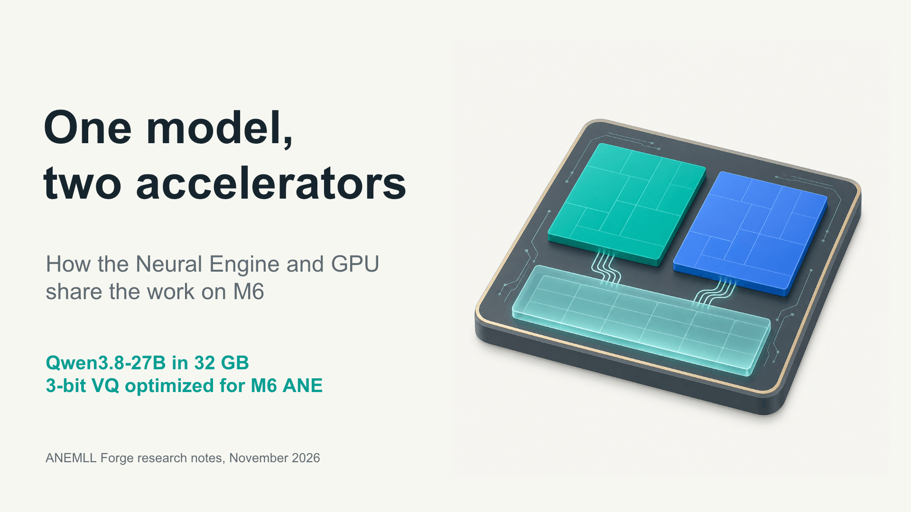
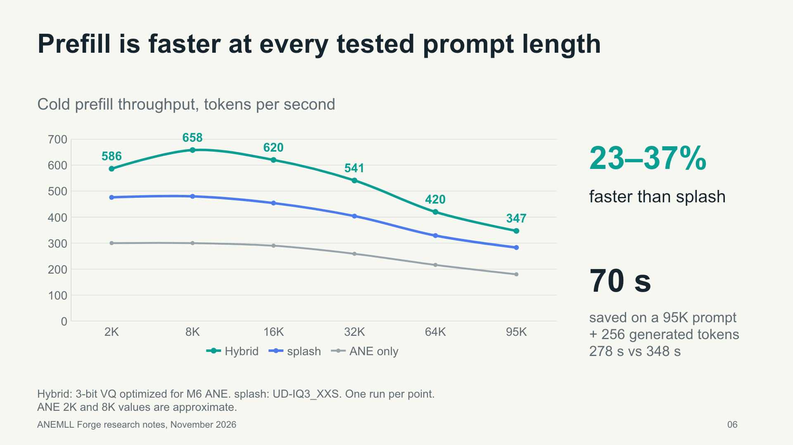
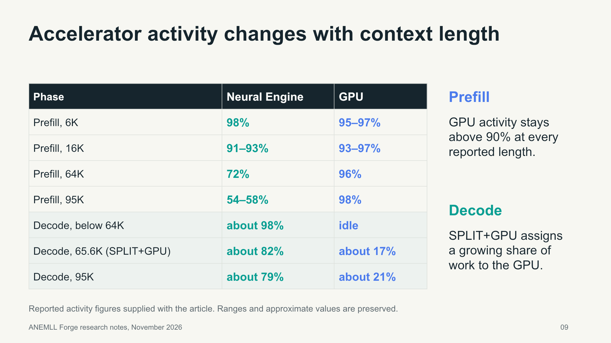
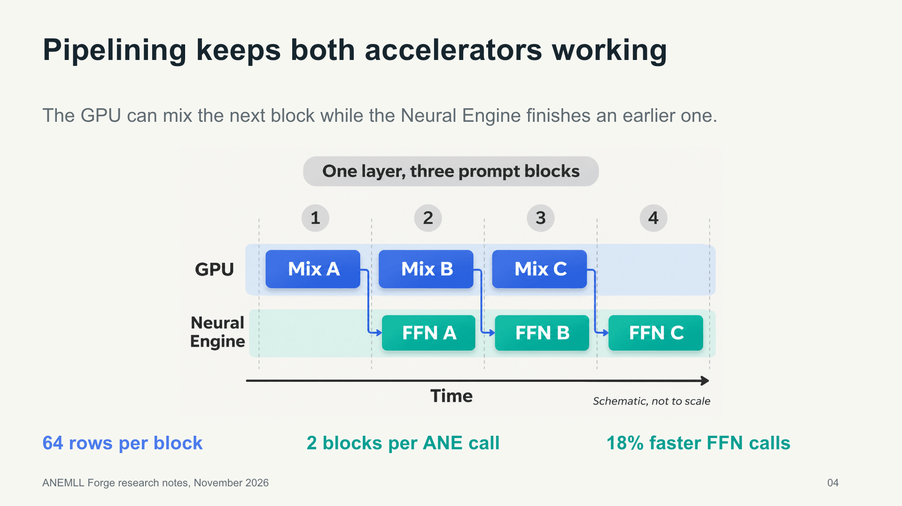
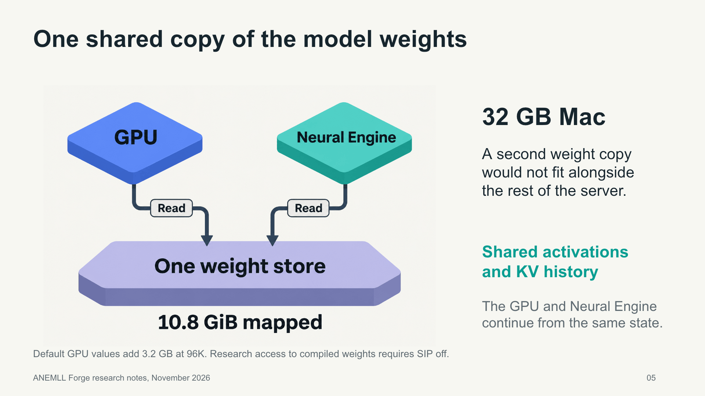
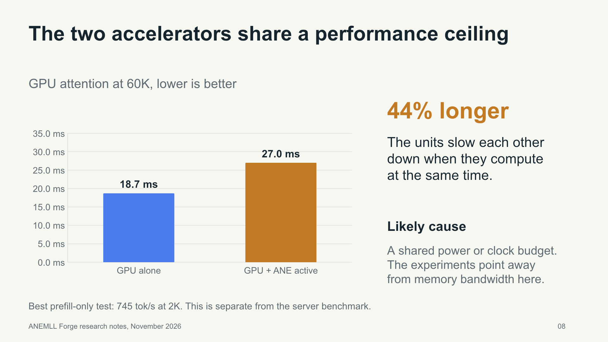

# One model, two accelerators: faster prefill and decode on the M6 with the Neural Engine and the GPU together

*ANEMLL Forge research notes, November 2026. A research build, separate from the release: it needs SIP turned off
([why](#research-environment-restrictions-why-it-needs-sip-off-and-root-permission-for-weights)).*

A Mac with an M6 has two large accelerators on one memory: the GPU and the Apple Neural Engine (ANE). Our release
runs Qwen3.8-27B on the Neural Engine alone, and GPU engines such as splash run it mostly on the GPU. This is the
story of running one model on both at the same time (the "hybrid"; V8 is its research name in our notes): why, how it
compares with splash 1.3.2, what we optimized, and which decisions we made along the way.

## Why

**Long prompts are slow.** Qwen3.8-27B at three bits fits on a 32 GB M6, but coding agents send long prompts: the
whole conversation, file contents, tool output. Our Neural Engine release prefills about 300 tokens per second at 2K
to 8K tokens and 180 at 96K. A cold 64K-token context takes about five minutes before the first answer token, and an
agent pays that again every time its context is compacted or edited.

*Prefill time for a 64K-token prompt: about five minutes on the Neural Engine alone, about two and a half on the hybrid.*

**Half the chip sits idle.** While the Neural Engine prefills, the GPU does nothing; a GPU engine leaves most of the
Neural Engine idle. Both units read the same unified memory, so in principle they can work on one model without
copying anything between them.

**The two units are good at different parts of the model.** Qwen3.8-27B has 64 layers: 48 Gated DeltaNet layers (a
linear-attention mixer with a recurrent state) and 16 full-attention layers, each followed by a feed-forward network
(FFN). We timed every part on both units:

- The FFNs, which hold most of the weights, run 1.56 times faster on the Neural Engine (23.2 against 36.3
  microseconds per token per layer, with our palettized VQ 3-bit weights).
- The token mixers (DeltaNet and attention) cost about the same on both units, and attention gets more expensive as
  the context grows.

*The prefill split: the GPU runs the token mixers (48 DeltaNet, 16 full attention), the Neural Engine every FFN, where it is 1.56 times faster.*

So the plan was simple to state: FFNs on the Neural Engine, mixers on the GPU, both busy at once. The goal was 700 to
1000 tokens per second of prefill, with decode no slower than before.

## Results against splash 1.3.2

[Splash](https://github.com/incoai/splash) 1.3.2 (incoai, Apache-2.0), the version every comparison in this article
uses, is an open GPU+ANE engine that runs the same base model on Apple silicon. It also uses both units, but differently: its GPU runs the whole model, and during prefill (chunks
of 512 rows or more) it hands a calibrated share of each FFN's channels to the Neural Engine as an INT8 program.
Decode runs on its GPU. It runs a different three-bit model file (unsloth UD-IQ3_XXS GGUF) from ours (the release 0.2
VQ weights), so the answers and their speculative acceptance differ.

The same requests on both servers at 96K context, one server at a time on the same M6 (client times, one run per
point). Splash 1.3.2 and the hybrid's prefill and follow-ups come from one 16 Nov session; the hybrid's decode cycle comes
from the 17 Nov rerun with the decode work below (`results/cmp_v8dec8_96k.jsonl`), whose prefill matched the 16 Nov
run within run noise (576 to 668 tok/s at 2K to 16K, 429 at 64K, 358 at 95K):

| prompt | Anemll-cold prefill, tok/s (16 Nov) | Splash 1.3.2 | ANE only | follow-up, ttft: hybrid (16 Nov) | splash 1.3.2 | decode cycle: hybrid, SPLIT+GPU (17 Nov) | splash 1.3.2 |
|---|---|---|---|---|---|---|---|
| 2K | **586** | 476 | about 300 | **1.04 s** | 1.48 s | **107 ms** | 116 ms |
| 8K | **658** | 480 | about 300 | **1.15 s** | 1.58 s | **111 ms** | 119 ms |
| 16K | **620** | 454 | 290 | 1.90 s | **1.73 s** | **119 ms** | 122 ms |
| 32K | **541** | 404 | 259 | **1.75 s** | 2.09 s | 133 ms | **131 ms** |
| 64K | **420** | 329 | 216 | **2.36 s** | 2.71 s | 141 ms | 141 ms |
| 95K | **347** | 283 | 180 | **2.92 s** | 3.34 s | 149 ms | **148 ms** |

- **Prefill:** the hybrid leads splash 1.3.2 by 37% to 23%   at every length and roughly doubles the Neural Engine alone.
- **Follow-up turns** (the cold prompt, the model's own answer, then 300 new tokens): faster at five of six lengths.
- **Decode:** the cycle (one draft plus one verification) is faster up to 16K and about the same as splash 1.3.2 from 32K.
  Before the decode work described below, it was 5 to 8% slower than splash 1.3.2 from 64K.
- **End to end**, a 95K cold prompt plus 256 generated tokens: 278 s on the hybrid, 348 s on splash 1.3.2.

**Why the hybrid prefills faster.** Both engines use the GPU and the Neural Engine, but they expose different
parallelism. The difference is what overlaps:

| | Hybrid | Splash 1.3.2 |
|---|---|---|
| Neural Engine work | every FFN | 76% of each FFN's channels (the share it calibrates on this M6, on chunks of 512 rows or more) |
| GPU work | the mixers | the mixers, the remaining FFN channels, and the next layer's INT8 weights for the Neural Engine |
| What runs at the same time | the GPU mixes block B while the Neural Engine runs block A's FFN | the GPU and Neural Engine portions of one FFN |
| Before moving on | each block follows its own dependencies; other blocks keep going | the two FFN portions join before the next layer |

Splash's side comes from its source (`runtime/ops/AneFfn.hpp` and its model loop). Ignoring overhead and contention, a
splash layer takes roughly the mixer time plus the slower FFN portion, and during the mixer its Neural Engine has
nothing to do: on this M6 it was busy only about 42% of each 2,048-row prefill chunk (measured 13 Nov). In steady
state the hybrid takes roughly the larger of all GPU mixer work and all Neural Engine FFN work, plus pipeline fill and
drain, and both units stay more than 90% busy up to 16K. The hybrid's GPU also has less competing work: no FFN
channels and no weight preparation, which the shared compiled weights make possible without a second copy of the
model. Kernel tuning adds to this (18% faster Neural Engine FFN calls, DeltaNet layers from 2.59 to 1.97 ms per 128
rows), measured against our own earlier versions, not against splash's kernels. The lead shrinking from about 37% at
8K to 16K to 23% at 95K fits this picture: at long context the GPU's attention dominates in both engines, leaving less
FFN time to hide. We can name these mechanisms but have not measured each one's share of the 23 to 37%: that needs
matched phase profiles or controlled scheduling ablations, and the two engines use different quantizations.

Against one baseline, with the same requests: splash 1.3.2 on its GPU alone (`--disable-ane`, measured 17 Nov)
prefills 319, 317, 306, 282, 244 and 217 tokens per second at 2K, 8K, 16K, 32K, 64K and 95K. Its Neural Engine split
raises that 1.3 to 1.5 times (476 at 2K, 283 at 95K); the hybrid prefills 1.6 to 2.1 times splash's GPU-only rate (586,
347) and about twice our own Neural Engine-only build. Each unit alone is close: splash 1.3.2's GPU-only prefill
matches our Neural Engine-only build up to 16K (about 300) and leads it at long context (244 against 216 at 64K).

*Cold prefill throughput at 96K context, one run per point. Splash here is splash 1.3.2, incoai's GPU+ANE engine.*

**How busy each unit is.** The share of wall time each unit spends working:

| phase | Neural Engine | GPU |
|---|---|---|
| prefill, 6K prompt | 98% | 95 to 97% |
| prefill, 16K | 91 to 93% | 93 to 97% |
| prefill, 64K | 72% | 96% |
| prefill, 95K | 54 to 58% | 98% |
| decode, up to 64K | about 98% | idle |
| decode, 65.6K (with the GPU attention described below) | about 82% | about 17% |
| decode, 95K | about 79% | about 21% |

In prefill both units work at the same time: up to 16K both are more than 90% busy, and from 64K the GPU's attention
becomes the bottleneck, so the Neural Engine waits more. In decode the units take turns within each verification step:
below 64K the GPU is idle, and past it the GPU takes about a fifth of each cycle. Busy is not full speed: the two units
slow each other down when both work (see "The ceiling we hit" below). Prefill shares come from the driver's timelines
(the 95K row is a 97K-token run); decode shares from the server log, where the GPU's part is its attention time per
verification step (24.4 ms of a 141 ms cycle at 65.6K, 31.0 of 149 at 95K, hand-over latency included) and the rest is
the drafter and the verification on the Neural Engine plus about 1 ms on the host.

*The busy shares from the table above.*

**In a real coding agent.** We ran the same Pi coding-agent prompts on both servers (the hybrid and splash 1.3.2), with the same sampling and the
same thinking budget. A hidden test suite of 1,373 checks graded a cron-expression library that both models wrote:
both scored 1,373 of 1,373. Decode speed was within 6% (31.8 against 33.7 tokens per second). Each run took as long as the model's behavior made it (how many tests it wrote, how many debugging turns it
needed), which varies from run to run. A single-turn probe showed no difference in how much either model thinks or
writes per answer.

## How we optimized prefill

**What is new here.** Two things, and they go together. First, both units do real model work at the same time: the
Neural Engine runs every FFN and the GPU runs every mixer, pipelined over the prompt, and both are more than 90% busy
up to 16K. Second, neither unit prepares data for the other: the GPU computes straight from the Neural Engine's
compiled weights, decoding their palettes inside its own kernels, with no second copy and no conversion pass. Splash 1.3.2
takes the other route: its GPU runs the whole model and hands part of each FFN to the Neural Engine, and to feed that
part it requantizes those weights to INT8 on the GPU one layer ahead, so some of the GPU's time goes to preparing the
Neural Engine's input, and the two units join on every layer. Our own runtime-INT8 test points the same way: with the
GPU expanding the FFN weights to INT8 for the Neural Engine, the Neural Engine's FFN got faster but the GPU became the
bottleneck, and 2K prefill fell from 742 to 630 tokens per second. That test also changed the schedule (1,024-row
waves), so it does not isolate the cost of preparing weights by itself.

**1. Split by layer type and pipeline it over the prompt.** This works because of prefill: the whole prompt is known
up front, so it can be cut into blocks of 64 tokens, and different blocks can be at different stages at the same time.
Two facts make the overlap safe:

- **An FFN works on each token by itself.** Block A's FFN in layer L changes only block A's tokens, and its output
  feeds only block A's next layer.
- **A mixer only looks backward.** Block B's mixer in layer L needs block B's own input (its output from layer L-1)
  and what the earlier tokens left in this layer: block A's keys and values for attention, or the DeltaNet recurrent
  state after block A. Block A's mixer produced those, not block A's FFN.

So once the GPU has mixed block A, the Neural Engine runs block A's FFN while the GPU mixes block B, then block B's FFN
while the GPU mixes block C. The rule in the scheduler: the GPU mixes layer L of block k once it has mixed layer L for
every earlier block and block k has finished the FFN of layer L-1. Over 64 layers this becomes a wavefront: different
blocks are at different layers at the same moment, and both units always have work. In practice the GPU mixes two
blocks per call (128 rows) and several blocks are in flight. Activations pass through the Neural Engine's own buffers
(IOSurfaces), with no copies.

*Schematic of one layer: the GPU mixes the next block while the Neural Engine runs the FFN of the block before it. In the real schedule this is a wavefront over the layers, and the GPU mixes two blocks per call.*

Decode cannot do this: it produces one token at a time, so there is no later block to work on while the current one
finishes. In decode the two units take turns instead (see "How we optimized decode").

**2. Keep the weights once.** A second copy of the weights for the GPU would not fit next to everything else in 32 GB.
Core AI packages carry no compiled Neural Engine program: macOS compiles each one on first load and keeps the result
(`model.hwx`) in a system cache. We decoded the Neural Engine's palettized weight layout inside those files, and the
GPU kernels read the weights straight from them (10.8 GiB mapped, zero-copy). The Core AI packages are built so that
one package serves both the plain model and the hybrid's entry points, storing each weight once.

*One copy of the weights: the GPU maps the Neural Engine's compiled 3-bit weights (10.8 GiB) instead of loading its own.*

**3. Give the Neural Engine fewer, bigger calls.** Every Neural Engine evaluation has an idle gap of about 0.23 ms in
the driver or firmware that no submission trick hides. Running two 64-row blocks per call and splitting each FFN's
intermediate dimension into two chunks of the same palette made the FFN call 18% faster; 2K prefill went from about
575 to about 630 tokens per second.

**4. Fix the threading.** A separate GPU waiter thread keeps submission from blocking. Calling the same Core AI
function from two threads at once corrupted outputs at random, even with different bindings, so each pair of blocks
gets one Neural Engine thread.

**5. Make the GPU kernels lean.** INT8 everywhere it costs no quality: INT8 x INT8 matrix products for the DeltaNet
projections (Metal 4's tensor operations), INT8 attention scores, fused normalization, rotation, convolution and gating.
A DeltaNet layer went from 2.59 to 1.97 ms per 128 rows.

**6. Share the KV cache.** The GPU attention reads and writes the Neural Engine's INT8 key/value cache in place, so
decode can continue from a prefill without copying anything. The first version lost quality: a product of a
probability and a value scale went subnormal in FP16 (about 1% error), fixed by rescaling. The server default keeps
INT8 keys and an FP16 copy of the values on the GPU (3.2 GB at 96K) for a faster value product.

**7. The ceiling we hit: the two units slow each other down.** Running both at once costs each some speed: the GPU's
attention call at 60K takes 18.7 ms alone and 27 ms (+44%) while the Neural Engine works, and the Neural Engine's FFN
slows 3 to 20% under GPU load. The cause is matrix work on both sides, not memory traffic. Under three kinds of GPU
load the Neural Engine slowed 3% (plain arithmetic), 7% (a 153 GB/s memory stream) and 20% (our INT8 DeltaNet matrix
loop); in the other direction, a Neural Engine program with few weights but heavy compute slowed the GPU as much as
the weight-heavy FFN, and the GPU slows only once the Neural Engine is more than about 50% busy. Our best explanation
is a shared power or clock limit on the two matrix engines (the power controller lowering one unit's clock when the
other draws more), so their separate peak speeds do not add up. It is a hypothesis: we did not record power or clocks,
and contention in the shared system cache for matrix work would fit the same tests. Sampling GPU frequency and Neural
Engine power (`powermetrics`) while both units work would settle it.

This is also part of why the split pays off. The mixers are only partly matrix work (the DeltaNet recurrence is a
serial chain, plus norms, convolutions, gates and the softmax), so while the Neural Engine runs the matrix-heavy FFNs,
the GPU's matrix units are not fully loaded and the budget has room for both. At long context the GPU's attention,
which is mostly matrix work, takes over, and the units slow each other more. That reading comes from these stress
tests; we have not measured how much of the mixers' time is matrix work. It is also separate from heat: thermal drift
under minutes of sustained load costs 5 to 10% and goes away after 5 minutes idle (we compare only interleaved runs),
while this coupling is larger, appears as soon as both units work and depends on the kind of work.

What we did about it: we did not remove the ceiling, we designed around it.

- **A split that suits it:** the matrix-heavy FFNs on the Neural Engine, the partly-matrix mixers on the GPU.
- **Less GPU time per layer:** the fused INT8 kernels of step 5 (a DeltaNet layer from 2.59 to 1.97 ms per 128 rows).
- **Every offload judged on the pair, end to end and interleaved, not on each unit's own timing.** That rejected moves
  the per-unit arithmetic favored: DeltaNet mixers on the Neural Engine (+2 to 3% at 64K and above, worse below),
  attention projections on the Neural Engine at short context (they help only where the GPU is the bottleneck, and
  cost 9% at 2K), and runtime-INT8 FFN waves sized for the Neural Engine alone.

What remains is the ceiling itself: the best prefill-only run reached 745 tokens per second at 2K, short of the 1,000
we hoped for. The levers left are in "What is next".

*GPU attention at 60K, alone and while the Neural Engine works: the two units share a performance ceiling.*

## How we optimized decode

**How decode works here.** Decode uses speculative decoding: a small drafter (DFlash2) proposes 7 tokens, and the
27B target checks them in one 8-row verification call. Accepted tokens cost one cycle together. The verification takes
85 to 90% of the cycle, and it runs on the Neural Engine.

*Speculative decoding: the drafter proposes 7 tokens and the target checks them in one 8-row verification, 85 to 90% of the cycle.*

**The problem past 64K.** A Neural Engine program has fixed shapes, so its attention runs over the whole context entry
it was compiled for (8K, 16K, 32K, 64K or 96K), not over the tokens actually used. One verification step costs 85 ms in
the 16K entry and 122 ms in the 96K entry. A 65.6K-token conversation already runs in the 96K entry, and it decoded 8%
slower than splash 1.3.2, whose GPU attention follows the real length.

**SPLIT+GPU.** We split each verification step around the 16 full-attention layers. The Neural Engine runs everything
up to an attention layer's query, key and value projections; the GPU runs the attention over the actual KV history;
the Neural Engine finishes that layer and starts the next one in the same call. Everything else (the 48 DeltaNet
layers, every FFN, every projection) stays on the Neural Engine. The Neural Engine parts bind no KV cache and no mask,
so **one compiled program serves every context length**: a 131K-token context ran a verification step in 139 ms with
no recompile.

*SPLIT+GPU: past 64K the attention over the actual KV history moves to the GPU; the rest of the verification stays on the Neural Engine.*

**The kernel.** Our first decode-attention kernels reached only about 35 GB/s: decode has eight query rows, and the
kernels walked their keys in sequence. The tuned kernel multiplies INT8 queries by INT8 keys into INT32 scores, keeps
the softmax in FP32 and multiplies FP16 probabilities by INT8 values. It splits the keys into 2,048-key chunks, runs
three threadgroups of 16 query rows per KV head and chunk (each KV head serves 48 rows: 6 query heads times 8
positions) and keeps the scores in registers. It reads 127 GB/s back to back.

**Bandwidth.** On this M6 (170 GB/s peak) a plain GPU read streams 156 GB/s and the split's Neural Engine calls 121
GB/s; running both at once reaches 164 GB/s. Decode is close to the memory wall. In the server the kernel reaches
about 90 to 100 GB/s, because the GPU starts cold after every Neural Engine call, and every hand-over between the two
units costs about 0.65 ms.

**Result.** The decode cycle went from 153 to 141 ms at 64K and from 155 to 149 ms at 95K, the same as splash 1.3.2.

*Decode cycle at 64K and 95K before SPLIT+GPU, with it, and on splash 1.3.2 (incoai's GPU+ANE engine).*

## Decisions we made

1. **Split by layer type, not by layer range or by tensor.** Our first hybrid ran contiguous layer ranges on each unit
   (486 tokens per second at 8K, about splash 1.3.2's speed). Mixers on the Neural Engine with FFNs on the GPU was GPU-bound;
   splitting each matrix product across both units needs a sync per product. The layer-type split won on arithmetic
   and in practice.
2. **Read the Neural Engine's compiled weights in place.** This is what makes the hybrid fit in 32 GB, and it is also
   why it needs System Integrity Protection off (below). We accepted that for research.
3. **Core AI for the Neural Engine, our own Metal engine for the GPU.** Core AI's own GPU path was far too slow for the
   GPU half: 89.5 ms for one FFN call (our Metal engine: 4.6 ms), 438 ms for a DeltaNet mix, and 118 s to load a
   chunk while expanding its weights in memory.
4. **INT8 keys with FP16 values on the GPU as the default.** The all-INT8 cache is lossless but 4 to 6% slower at 64K
   and above; the FP16 value copy costs 3.2 GB at 96K and fits.
5. **Measured, kept out of the server:** runtime-INT8 FFNs on the Neural Engine (+6 to 10% at 6K to 16K, but no room
   in memory at 64K and above), DeltaNet mixers on the Neural Engine (+2 to 3% at 64K and above, worse below),
   switching attention projections by position (+0.5%).
6. **SPLIT+GPU only in the 96K entry.** In the 16K and 32K entries the split is 8 to 17% slower and in the 64K entry
   about even, because the Neural Engine's own attention is cheap there and each hand-over costs 0.65 ms. Packages of
   eight layers let one call finish an attention layer and start the next, which saves a hand-over per pair.
7. **Rejected for decode, all measured:** attention on both units split by key range (about 1 ms per step), FP8
   probabilities (no gain, twice the error), single-simdgroup register softmax (2.7 to 4.4 times slower), prefetching
   the next key/value tile (8 to 27% slower wherever we placed it), double buffering (86% slower), spin waits and GPU
   warm-up kicks (they slow the Neural Engine call), and Core AI's compute streams (they do not order Neural Engine
   and GPU work on macOS 27.3).
8. **A thinking budget for effort "medium".** Our server closes the model's thinking at 6,144 tokens with Qwen's own
   budget phrase; splash 1.3.2 has no cap by default. On the graded coding task the cap cost nothing (1,373 of 1,373 either
   way) and saved a 14-minute first turn.
9. **Keep it on a research branch.** It needs system changes no release should ask for.

## Research environment restrictions: why it needs SIP off and root permission for weights

Core AI is not designed to run one model on the Apple Neural Engine and the GPU at the same time. It runs a model on
either unit, but it gives the GPU no way to use the weights the Neural Engine already holds, and its own GPU path was
far too slow for the hybrid's GPU half (decision 3). That doesn't mean Apple won't support this in the future. For
research, we work around it: we turn SIP off and let our GPU engine read the Neural Engine's compiled program (its
HWX file) directly, after a one-time root permission grant.

What that involves: macOS compiles each Core AI package for the Neural Engine the first time it loads, and keeps the
result, `model.hwx`, in `/Library/Caches/com.apple.aned/<macOS build>/ModelAssetsCache/`. The hybrid maps the weights
inside those files into the GPU's memory, read-only and without a copy (10.8 GiB), so the model's weights exist only
once; a second copy would not fit on a 32 GB Mac. Two protections stand in the way:

- **Root permission, once.** The cache directory belongs to root with mode 700, so a normal user cannot open it. One
  `sudo chmod +a` gives your user read access. Nothing is ever written to the cache.
- **SIP off.** The cache also carries macOS's `datavault` flag, which System Integrity Protection enforces even against
  root: with SIP on, not even sudo can read it. SIP has to be disabled from macOS Recovery, which lowers the security
  of the whole Mac, so use a dedicated research machine.

One more consequence: the GPU tables point into those compiled files and match only the M6 compiler's output on
macOS 27.3. They are rebuilt after every recompile (a macOS update or a cache purge), and other chips are not
supported. Commands and details: [Requirements: root and SIP](README.md#requirements-root-and-sip).

*The research build's constraints and next steps.*

## Reproduce it

Everything is on the ANEMLL Forge research branch `v8-gpu-ane-prefill`, in
[https://github.com/Anemll/anemll-forge/tree/v8-gpu-ane-prefill/research/v8_prefill](https://github.com/Anemll/anemll-forge/tree/v8-gpu-ane-prefill/research/v8_prefill):

| step | where |
|---|---|
| Set up the Python and Core AI environment | [main README, section 1](../../README.md#1-set-up-the-inference-environment) |
| Download the packages, drafter and model files | Hugging Face [anemll/anemll-forge-qwen3.8-27B-V8-96K](https://huggingface.co/anemll/anemll-forge-qwen3.8-27B-V8-96K) (research preview; being updated to the SPLIT+GPU build) |
| Turn SIP off and grant read access to the compiled weights | [Requirements: root and SIP](README.md#requirements-root-and-sip) |
| Compile the packages, build the GPU tables and the GPU engine libraries | [Build chain](README.md#build-chain) (steps 3 to 6) |
| Start the server (OpenAI API on port 8765) | [Run](README.md#run) and [the server notes](pipe/V8_SERVER.md) (options, request flow, results) |
| Point Pi at it | [main README, section 5](../../README.md#5-apply-the-pi-configuration-patches) (provider `ane-qwen38`, port 8765) |
| Measure | `pipe/unit/cmp_bench.py` and `splash132/cmp_96k.sh` (the 96K table), `bench/cron/` (the coding prompt and its hidden grader) |

**Today's limits.** The GPU tables are built from the release export, which is not public yet, and the research
scripts use the development machine's absolute paths (listed in the [research README](README.md)). A portable kit is
the next step: a launcher that takes the download folder, the tables shipped with a check against the local compile,
and a Pi configuration entry. Until then, reproducing the hybrid needs that export.

## Lessons that carry over

- **Fewer, bigger Neural Engine calls.** The fixed per-call gap dominates small calls.
- **Never call one Core AI function from two threads at once.** The outputs go wrong without an error.
- **Fast Neural Engine INT8 forms can be silently wrong.** Two matrix shapes we tried computed wrong results with
  nothing to signal it; check every new form against a host reference.
- **Measure the pair, not each unit.** On the M6 the Neural Engine and the GPU slow each other down; their separate
  ceilings do not add up.
- **Weights once.** On a 32 GB Mac any duplicate of a 27B model's weights decides what fits.
- **Compare only back-to-back or interleaved runs.** Thermal drift is 5 to 10% within minutes.
- **Prove which code ran.** A shell that silently ignored our environment switches once made a whole batch of kernel
  variants measure the same kernel; every variant now prints a checksum of its output.

## What is next

- Runtime-INT8 FFNs on the Neural Engine at 6K to 16K (+6 to 10%), once memory allows.
- DeltaNet projections on the Neural Engine at long context (estimated about 520 tokens per second at 64K).
- The GPU's cold start after each Neural Engine call (about 10 ms per decode step at 95K), and splash 1.3.2's higher
  acceptance per cycle.
- Serving 128K: the split already runs there without a recompile; the server needs its key/value cache and prefill
  extended past 96K.

Code, numbers and every rejected variant: [README.md](README.md), [PREFILL_RESEARCH.md](PREFILL_RESEARCH.md) and
[pipe/unit/DECODE_GPU_ATTENTION.md](pipe/unit/DECODE_GPU_ATTENTION.md).
