# One model, two accelerators: faster prefill and decode on the M6 with the Neural Engine and the GPU together

*ANEMLL Forge research notes. **Version 2, November 19, 2026:** the hybrid as of V8.2, measured against Splash 1.7.0.
Version 1 (November 17) covered V8 against Splash 1.3.2. A research build, separate from the release: it needs SIP
turned off ([why](#research-environment-restrictions-why-it-needs-sip-off-and-root-permission-for-weights)).*

**22 November follow-up.** The served eight-row tree now has direct comparisons with the eight-row chain. The illustrated paper includes both launch orders, the tool-agent regression, and the fixed-spine replay. [Read the tree-verification paper](TREE_VERIFY.html) Since 22 Nov the server also uses sliced verify entries at 24K / 40K / 48K / 56K (+3.4% pooled over a 19-turn Pi-like session, identical replies), and a fix for a GPU-engine memory leak at context switches (`results/22nov/memleak`). The build, a portable GPU-table kit and the build, deploy and test steps for another Mac: [hf/DEPLOY.md](hf/DEPLOY.md). [Tree verification, simply](TREE_VERIFY_SIMPLE.html) (a plain-language version)

A Mac with an M6 has two large accelerators on one memory: the GPU and the Apple Neural Engine (ANE). Our release
runs Qwen3.8-27B on the Neural Engine alone, and GPU engines such as Splash run it mostly on the GPU. This is the
story of running one model on both at the same time: the "hybrid", V8 in our notes and Forge V8-research in the
charts. It covers why, what we built and measured in three steps (V8, V8.1 and V8.2), how V8.2 compares with Splash
1.7.0, and which decisions we made along the way.

**Where it stands: V8.2 against Splash 1.7.0** (19 Nov, 2K to 96K, one matched run started cool):
- **Prefill:** 24 to 40% faster at every length, for example 685 against 489 tokens per second at 8K and 389 against
  314 at 96K.
- **Decode:** within -4% to +6% of Splash at every length (45.3 against 44.4 tokens per second at 96K).
- **Energy:** 41 to 50% less whole-machine energy above idle per generated token, and 15 to 24% less per prompt token
  at 8K to 96K.

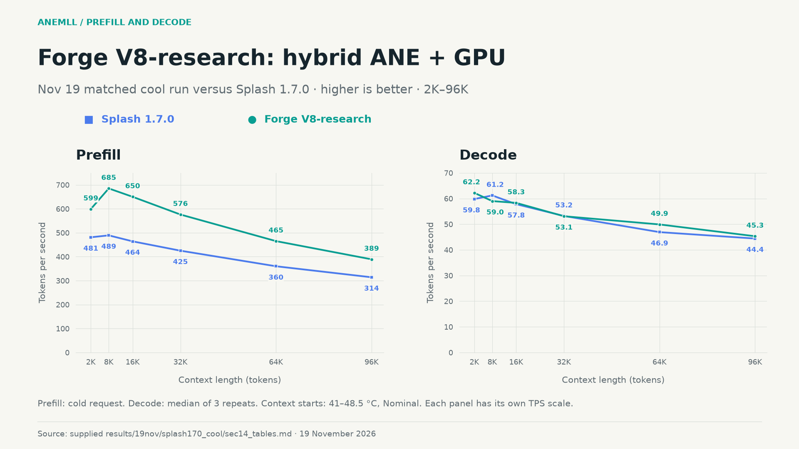

*V8.2 against Splash 1.7.0, prefill and decode, 19 Nov matched cool run. Each panel has its own scale.*

## From V8 to V8.2

**V8 to V8.2 TLDR:** Up to 12% faster prefill from GPU causal attention optimizations (FP8 P·V + 16 KB on-chip Q·K scratchpad), plus up to 13% faster >64K Hybrid ANE+GPU decode (150 -> 133 ms/cycle at 66K) by using a lightweight GPU keep-alive to stop GPU clocks from dropping between ANE verify steps.

| version | date | built or measured | effect |
|---|---|---|---|
| **V8** | 16-17 Nov | **Hybrid prefill:** every FFN on the Neural Engine, every mixer on the GPU, pipelined over 64-token blocks, with the GPU reading the Neural Engine's compiled weights in place. **SPLIT+GPU decode:** past 64K the verification's 16 attention layers run on the GPU over the actual KV history. | Prefill 586 tokens per second at 2K and 347 at 95K, 23 to 37% faster than Splash 1.3.2. The decode cycle at 95K went from 155 to 149 ms. |
| **V8.1** | 18 Nov | **The coupling's cause measured:** DRAM bandwidth and latency, not power ([Two accelerators, one memory](ARTICLE_CONTENTION_M6.md)). **FP8 probabilities and values** in the GPU's prefill attention (`F8=x`). **A GPU clock keep-alive** for split-verification decode past 64K (`DEC_KA_HOLD_MS=60`). | Prefill +4.5% at 32K, +8.2% at 64K, +9.4% at 95K. The decode cycle at 66K went from 150 to 133 ms, for about 2.7 W. |
| **V8.2** | 19 Nov | **An on-chip scratch buffer for the Q·K write-back** in the GPU's prefill attention (`QKE=tg`). **A matched, cool benchmark** against Splash 1.7.0: speed, plus whole-machine energy gross and above idle. **Every experiment of 18 and 19 Nov measured and recorded**, kept or rejected. | Prefill a further +1.5% / +1.6% / +2.4% (bit-exact). V8.1 and V8.2 together: +6% / +10% / +12% at 32K / 64K / 95K. |

Each change was served once measured: `F8=x` and the keep-alive on 18 Nov, `QKE=tg` on 19 Nov. The optimization
sections below tag every step with the version that brought it.

## Why

**Long prompts are slow.** Qwen3.8-27B at three bits fits on a 32 GB M6, but coding agents send long prompts: the
whole conversation, file contents, tool output. Our Neural Engine release prefills about 300 tokens per second at 2K
to 8K tokens and 180 at 96K. A cold 64K-token context takes about five minutes before the first answer token, and an
agent pays that again every time its context is compacted or edited.

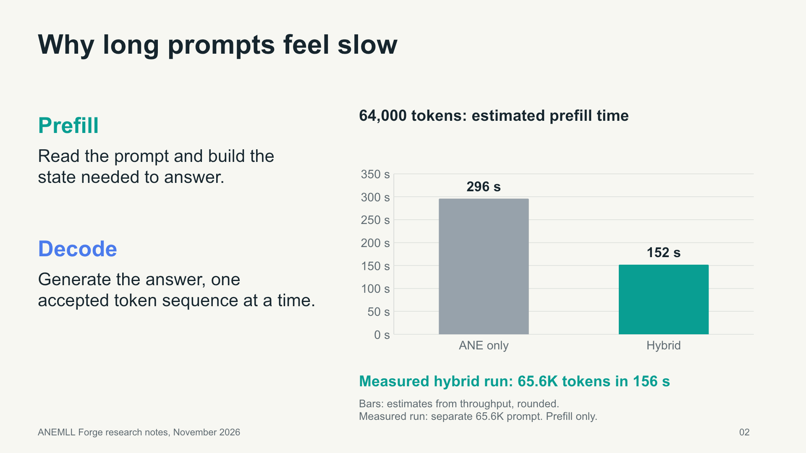

*Prefill time for a 64K-token prompt: about five minutes on the Neural Engine alone. V8-era figure (16 Nov
estimates); V8.2 measures 140 s for a 64,953-token prompt (465 tokens per second).*

**Half the chip sits idle.** While the Neural Engine prefills, the GPU does nothing; a GPU engine leaves most of the
Neural Engine idle. Both units read the same unified memory, so in principle they can work on one model without
copying anything between them.

**The two units are good at different parts of the model.** Qwen3.8-27B has 64 layers: 48 Gated DeltaNet layers (a
linear-attention mixer with a recurrent state) and 16 full-attention layers, each followed by a feed-forward network
(FFN). We timed every part on both units:

- The FFNs, which hold most of the weights, run 1.56 times faster on the Neural Engine (23.2 against 36.3
  microseconds per token per layer, with our palettized VQ 3-bit weights).
- The token mixers (DeltaNet and attention) cost about the same on both units, and attention gets more expensive as
  the context grows.

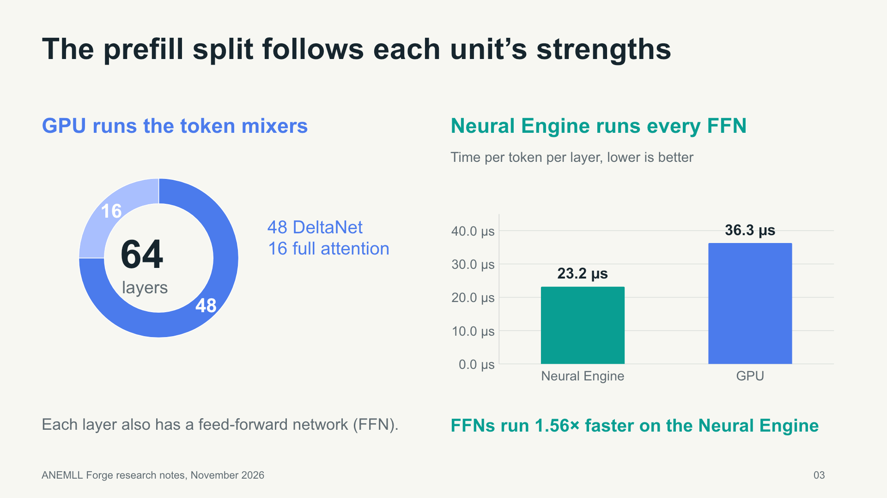

*The prefill split: the GPU runs the token mixers (48 DeltaNet, 16 full attention), the Neural Engine every FFN, where it is 1.56 times faster.*

So the plan was simple to state: FFNs on the Neural Engine, mixers on the GPU, both busy at once. The goal was 700 to
1000 tokens per second of prefill, with decode no slower than before.

## Results against Splash 1.7.0 (V8.2)

[Splash](https://github.com/incoai/splash) (incoai, Apache-2.0) is an open GPU+ANE engine that runs the same base
model on Apple silicon. It also uses both units, but differently: its GPU runs the whole model, and during prefill
(chunks of 512 rows or more) it hands a calibrated share of each FFN's channels to the Neural Engine as an INT8
program (1.7.0 reports a share of 0.76 on this M6). Decode runs on its GPU. Version 1.7.0 adds tree verification: up
to 16 draft rows per step, chosen from step costs it measures at start-up, plus prompt lookup. It runs a different
three-bit model file (unsloth UD-IQ3_XXS GGUF) from ours (the release 0.2 VQ weights), so the answers and their
speculative acceptance differ.

**How we measured** (19 Nov, 13:10 to 13:55; raw files in
[results/19nov/splash170_cool/](results/19nov/splash170_cool/)):
- **One server at a time** on the same M6, Splash 1.7.0 first, then the hybrid, in one continuous run
  ([`compare_cool.sh`](results/19nov/splash170_cool/compare_cool.sh)), with an external fan on the Mac.
- **Requests** ([`scripts/m6_compare_bench.py`](../../scripts/m6_compare_bench.py), once per context):
  - A cold prompt fills the context entry minus 512 tokens (1,529 to 97,785 tokens), followed by 256 greedy tokens.
  - Then 3 identical repeats from the prompt cache.
  - Prefill is the cold request; decode is the median of the 3 repeats.
  - Each run adds its own random nonce to the prompt, so no cached prefix carries over between runs.
- **Power:** mactop's `total_power` (the whole machine), sampled every second (about 1.2 s apart in practice).
  - The prefill window runs from the request to the first token; the decode window from the first to the last token
    of the median repeat.
  - Energy is the mean power times the window; J per token divides it by the prompt or generated tokens.
  - **Net** subtracts that context's own 30 s idle baseline, measured just before it. Splash: 4.25, 4.31, 4.29,
    4.21, 4.26 and 4.32 W at 2K, 8K, 16K, 32K, 64K and 96K. Hybrid: 3.73, 4.06, 4.09, 4.27, 4.24 and 3.83 W.
- **Thermal hygiene:** at least 180 s of cooldown before each server, until the SoC read 45 °C or less, and before
  each context until it read 48 °C or less. Every context started at SoC 41.3 to 48.5 °C and GPU 41.0 to 48.1 °C, with
  fan 0 at about 1,000 RPM (1,397 before Splash's 96K). The thermal state was Nominal throughout.
- **Identity:** each server printed a banner before any timed request.
  - Splash 1.7.0: git 61f6d516, binary sha256 4c20b1d0..., GGUF revision 4ca72078 (sha256 c0b7c303...), its defaults
    (`--verify-rows auto`) plus `--offline`.
  - Hybrid V8.2: launcher `v8_server_dec8_qk.sh`; prefill engine `libgpu_v8_f8q.dylib` (sha256 ea591258..., `F8=x`,
    `QKE=tg`); decode attention `dec_attn_r4` in `libdec_gpu_clk.dylib` (sha256 2b64e979...); keep-alive on, 60 ms
    hold.

**Prefill** (the cold request; W is whole-machine power, net is above that context's idle):

| context | prompt tokens | prefill tok/s, Splash / hybrid | W gross, S / H | W net, S / H | J per prompt token gross, S / H | J net, S / H | power samples, S / H |
|---|---|---|---|---|---|---|---|
| 2K | 1,529 | 481 / **599** (+24%) | 19.0 / 15.4 | 14.8 / 11.6 | 0.040 / **0.026** | 0.031 / **0.019** | 2 / 2 |
| 8K | 7,673 | 489 / **685** (+40%) | 43.1 / 48.2 | 38.8 / 44.1 | 0.088 / **0.070** | 0.079 / **0.064** | 13 / 9 |
| 16K | 15,865 | 464 / **650** (+40%) | 46.6 / 48.7 | 42.3 / 44.6 | 0.100 / **0.075** | 0.091 / **0.069** | 29 / 20 |
| 32K | 32,249 | 425 / **576** (+36%) | 45.7 / 48.0 | 41.5 / 43.8 | 0.108 / **0.083** | 0.098 / **0.076** | 64 / 47 |
| 64K | 64,953 | 360 / **465** (+29%) | 44.2 / 46.9 | 39.9 / 42.7 | 0.123 / **0.101** | 0.111 / **0.092** | 153 / 117 |
| 96K | 97,785 | 314 / **389** (+24%) | 44.0 / 45.4 | 39.6 / 41.5 | 0.140 / **0.116** | 0.126 / **0.107** | 264 / 211 |

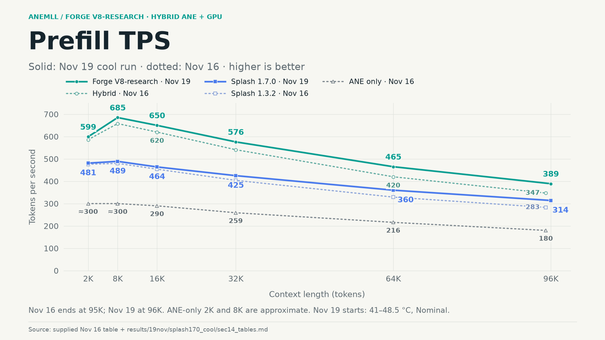

*Cold prefill throughput. Solid: V8.2 against Splash 1.7.0 (19 Nov). Dotted: the V8 baseline of 16 Nov (hybrid,
Splash 1.3.2, Neural Engine only; 95K is the last point there).*

**Decode** (the median of 3 repeats; the hybrid's cycle from its server log, Splash's from tokens per cycle divided
by tokens per second):

| context | decode tok/s, Splash / hybrid | tokens per cycle, S / H | cycle ms, S / H | W gross, S / H | W net, S / H | J per generated token gross, S / H | J net, S / H | power samples, S / H |
|---|---|---|---|---|---|---|---|---|
| 2K | 59.8 / **62.2** (+4%) | 6.9 / 6.56 | 115 / 108 | 42.1 / 23.9 | 37.9 / 20.2 | 0.702 / **0.384** | 0.631 / **0.324** | 4 / 3 |
| 8K | **61.2** / 59.0 (-4%) | 7.3 / 6.24 | 119 / 108 | 43.6 / 24.6 | 39.3 / 20.6 | 0.710 / **0.416** | 0.640 / **0.347** | 4 / 4 |
| 16K | 57.8 / **58.3** (+1%) | 7.1 / 6.40 | 123 / 112 | 44.4 / 24.6 | 40.1 / 20.5 | 0.766 / **0.421** | 0.692 / **0.351** | 3 / 4 |
| 32K | 53.2 / 53.1 (0%) | 7.1 / 6.24 | 133 / 120 | 41.8 / 24.7 | 37.5 / 20.4 | 0.782 / **0.463** | 0.703 / **0.383** | 5 / 4 |
| 64K | 46.9 / **49.9** (+6%) | 6.7 / 6.56 | 143 / 134 to 135 | 42.7 / 24.6 | 38.5 / 20.4 | 0.909 / **0.492** | 0.818 / **0.407** | 5 / 4 |
| 96K | 44.4 / **45.3** (+2%) | 6.9 / 6.40 | 155 / 144 to 146 | 43.2 / 27.4 | 38.9 / 23.5 | 0.970 / **0.602** | 0.873 / **0.518** | 5 / 5 |

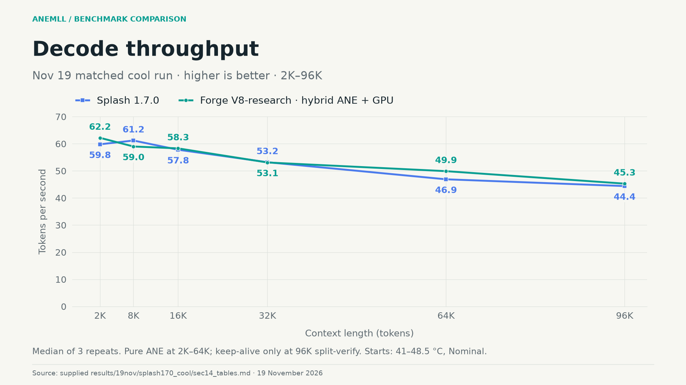

*Decode throughput, the median of 3 repeats. The hybrid's decode runs on the Neural Engine alone up to 64K; at 96K
the GPU runs the attention with the keep-alive.*

**Net energy saved per token, hybrid against Splash 1.7.0** (1 minus the hybrid's net J over Splash's):

| | 2K | 8K | 16K | 32K | 64K | 96K |
|---|---|---|---|---|---|---|
| prefill | 39% | 19% | 24% | 22% | 17% | 15% |
| decode | 49% | 46% | 49% | 46% | 50% | 41% |

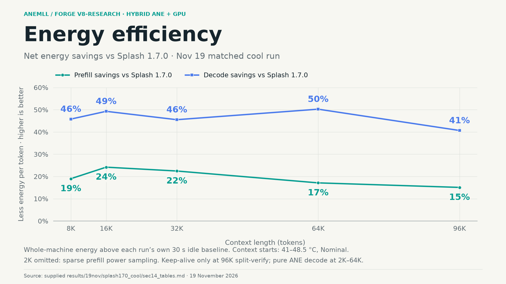

*Net energy saved per token against Splash 1.7.0, 8K to 96K. 2K is left out of the chart: each server's 2K prefill
window held only two power samples.*

- **Prefill:** the hybrid leads Splash 1.7.0 by 24% to 40% at every length: +40% at 8K and 16K, +24% at 2K and 96K.
- **Decode:** within -4% to +6% of Splash 1.7.0. The hybrid leads at 2K, 64K and 96K, trails at 8K and ties at 16K
  and 32K. Splash's trees accept 0.1 to 1.1 more tokens per cycle; the hybrid's cycle is 7 to 13 ms shorter.
- **Energy:** the hybrid uses 15 to 24% less net energy per prompt token at 8K to 96K, and 41 to 50% less per
  generated token at every length. In decode it draws 20 to 24 W above idle against Splash's 38 to 40 W: its decode
  runs on the Neural Engine, Splash's on the GPU. In prefill it draws slightly more power than Splash (42 to 45 W net
  against 40 to 42 at 8K and up) and finishes sooner.
- **Repeats are tight.** The hybrid's three decode repeats agree within 0.2 tokens per second up to 64K (44.8 to 45.5
  at 96K); Splash's agree within 1.6.
- **The keep-alive runs only in the 96K row.** Prompts above about 65.2K tokens move to the 96K entry, where the GPU
  runs the decode attention. The 64K row (64,953 tokens) decoded on the Neural Engine alone. The keep-alive's extra
  power shows in the 96K decode: 23.5 W net against 20.4 to 20.6 at 8K to 64K.
- **Heat matters.** An earlier run the same morning, after hours of benchmarks at up to about 90 °C, gave the hybrid
  579 tokens per second at 16K, 11% below this run's 650.

**V8.2 against V8.** The hybrid now prefills 599, 685, 650, 576, 465 and 389 tokens per second at 2K to 96K,
against V8's 586, 658, 620, 541, 420 and 347 (16 Nov, one 96K-context server, its last point a 95K prompt):
+2%, +4%, +5%, +6%, +11% and +12%. The gain grows with the context, as the V8.1 and V8.2 attention changes predict
(steps 8 and 9 below). At 2K to 8K, where they change nothing, the difference is within that of the two harnesses
(different prompts and context entries). Splash moved too: 1.3.2 prefilled 476 to 283 tokens per second at 2K to 95K,
1.7.0 481 to 314 at 2K to 96K. Decode below the 96K entry is unchanged since V8; in the 96K entry the V8.1 keep-alive
shortened the cycle.

### Why the hybrid prefills faster

Both engines use the GPU and the Neural Engine, but they expose different parallelism. The difference is what
overlaps:

| | Hybrid | Splash |
|---|---|---|
| Neural Engine work | every FFN | 76% of each FFN's channels (the share it calibrates on this M6, on chunks of 512 rows or more) |
| GPU work | the mixers | the mixers, the remaining FFN channels, and the next layer's INT8 weights for the Neural Engine |
| What runs at the same time | the GPU mixes block B while the Neural Engine runs block A's FFN | the GPU and Neural Engine portions of one FFN |
| Before moving on | each block follows its own dependencies; other blocks keep going | the two FFN portions join before the next layer |

Splash's side comes from its 1.3.2 source (`runtime/ops/AneFfn.hpp` and its model loop); 1.7.0 reports the same 0.76
share. Ignoring overhead and contention, a Splash layer takes roughly the mixer time plus the slower FFN portion, and
during the mixer its Neural Engine has nothing to do: on this M6 it was busy only about 42% of each 2,048-row prefill
chunk (1.3.x, measured 13 Nov). In steady state the hybrid takes roughly the larger of all GPU mixer work and all
Neural Engine FFN work, plus pipeline fill and drain, and both units stay busy: 96% and 83% at 2K, 97% and 95% at 8K. The hybrid's
GPU also has less competing work: no FFN channels and no weight preparation, which the shared compiled weights make
possible without a second copy of the model. Kernel tuning adds to this (18% faster Neural Engine FFN calls, DeltaNet
layers from 2.59 to 1.97 ms per 128 rows, FP8 values and a scratch buffer for the Q·K write-back in attention), measured against our
own earlier versions, not against Splash's kernels. The lead shrinking from about 40% at 8K and 16K to 24% at 96K fits
this picture: at long context the GPU's attention dominates in both engines, leaving less FFN time to hide. We can
name these mechanisms but have not measured each one's share of the 24 to 40%: that needs matched phase profiles or
controlled scheduling ablations, and the two engines use different quantizations.

### How busy each unit is (V8.2)

The share of wall time each unit spends working:

| phase | Neural Engine | GPU |
|---|---|---|
| prefill, 2K | 96% | 83% |
| prefill, 8K | 97% | 95% |
| prefill, 32K | 85 to 88% | 98 to 99% |
| prefill, 64K | 69% | 99% |
| prefill, 95K | 58 to 59% | 99 to 99.6% |
| decode, up to 64K | about 98% | idle |
| decode, 66K (split verification, keep-alive) | about 85% | about 14% |
| decode, 96K | about 80% | about 19% |

In prefill both units work at the same time: up to 8K both are busy 83 to 97% of the time (at 2K the Neural Engine
sets the pace), and from 32K the GPU's attention becomes the bottleneck, so the Neural Engine waits more. In decode the units take turns within each verification step:
below 64K the GPU is idle, and past it the GPU takes about a sixth of each cycle. Busy is not full speed: the two units
slow each other down when both work (see "The ceiling we hit" below).

The prefill shares come from the driver's timelines, in 19 Nov traces with FP8 values (`QKE=tg` adds 0.3 to 1.8
points to the Neural Engine). The decode shares come from the server log: the GPU's part is its attention time per
verification step, hand-over latency included, 19.2 ms of a 133 ms cycle at 66K and 26.7 of 142 at 96K. The rest is
the drafter and the verification on the Neural Engine, plus about 1 ms on the host.

*The V8 busy shares (V8-era figure, 16 and 17 Nov; the V8.2 shares are in the table above).*

### In a real coding agent (V8.2, 19 Nov)

Anemll's interactive Pi session against the served V8.2 (thinking medium, 12:46 to 12:58) asked for "a game of
tetris in HTML, test and fix" ([log summary](results/19nov/pi_session/summary.json)):
- **Outcome:** the model wrote a single-file Tetris (a 4,613-token `index.html`), built a Node test harness against a
  stub DOM, fixed a bug it found, and finished with its 17 assertions passing. It made 21 tool calls (13 bash, 5
  write, 3 edit) over 21 model requests.
- **Decode:** 19,174 tokens in 696 s, 27.5 tokens per second overall.
  - The file write ran at 51.9 tokens per second (5.84 tokens per verification, 69% of drafts accepted).
  - Thinking-heavy turns ran at 19 to 25 (18 to 27% accepted).
  - The cycle stayed at 112 to 113 ms in the 16K entry and 120 to 124 ms in the 32K entry, so speed followed the
    drafter's acceptance, not the hardware.
- **Prefill:** 2,375 new tokens in 10.8 s for the whole session. Each follow-up re-prefilled only 19 to 553 new tokens
  (0.2 to 1.4 s) from the prompt cache.
- **No split verification:** contexts stayed between 6.1K and 27.6K tokens, so the session never used the split
  verification or the keep-alive.

Version 1 compared the two engines on a graded task (17 Nov, Splash 1.3.2, the same prompts and thinking budget): both
models' cron-expression libraries passed all 1,373 hidden checks, and decode speed was within 6% (31.8 against 33.7
tokens per second). That comparison has not been rerun against Splash 1.7.0.

### Baseline: V8 against Splash 1.3.2 (16 and 17 Nov)

Version 1's comparison, the same requests in one 96K-context server per engine, one run per point:

| prompt | V8 prefill, tok/s | Splash 1.3.2 | Neural Engine only | V8 decode cycle | Splash 1.3.2 cycle |
|---|---|---|---|---|---|
| 2K | **586** | 476 | about 300 | **107 ms** | 116 ms |
| 8K | **658** | 480 | about 300 | **111 ms** | 119 ms |
| 16K | **620** | 454 | 290 | **119 ms** | 122 ms |
| 32K | **541** | 404 | 259 | 133 ms | **131 ms** |
| 64K | **420** | 329 | 216 | 141 ms | 141 ms |
| 95K | **347** | 283 | 180 | 149 ms | **148 ms** |

- **Follow-up turns** were faster on V8 at five of six lengths.
- **End to end,** a 95K cold prompt plus 256 tokens took 278 s on V8 and 348 s on Splash 1.3.2.
- **Splash on the GPU alone:** Splash 1.3.2 with `--disable-ane` prefilled 319 to 217 tokens per second at 2K to 95K,
  so its Neural Engine split was worth 1.3 to 1.5 times.

## How we optimized prefill

**What is new here.** Two things, and they go together. First, both units do real model work at the same time: the
Neural Engine runs every FFN and the GPU runs every mixer, pipelined over the prompt, and both are busy 83 to 97% of the
time up to 8K. Second, neither unit prepares data for the other: the GPU computes straight from the Neural Engine's
compiled weights, decoding their palettes inside its own kernels, with no second copy and no conversion pass. Splash
takes the other route (as its 1.3.2 source shows): its GPU runs the whole model and hands part of each FFN to the
Neural Engine, and to feed that part it requantizes those weights to INT8 on the GPU one layer ahead, so some of the
GPU's time goes to preparing the Neural Engine's input, and the two units join on every layer. Our own runtime-INT8
test points the same way: with the GPU expanding the FFN weights to INT8 for the Neural Engine, the Neural Engine's FFN
got faster but the GPU became the bottleneck, and 2K prefill fell from 742 to 630 tokens per second. That test also
changed the schedule (1,024-row waves), so it does not isolate the cost of preparing weights by itself.

Steps 1 to 6 are V8; step 7 is V8's ceiling with the cause V8.1 measured; steps 8 (V8.1) and 9 (V8.2) are the
attention changes since.

**1. Split by layer type and pipeline it over the prompt (V8).** This works because of prefill: the whole prompt is
known up front, so it can be cut into blocks of 64 tokens, and different blocks can be at different stages at the same
time. Two facts make the overlap safe:

- **An FFN works on each token by itself.** Block A's FFN in layer L changes only block A's tokens, and its output
  feeds only block A's next layer.
- **A mixer only looks backward.** Block B's mixer in layer L needs block B's own input (its output from layer L-1)
  and what the earlier tokens left in this layer: block A's keys and values for attention, or the DeltaNet recurrent
  state after block A. Block A's mixer produced those, not block A's FFN.

So once the GPU has mixed block A, the Neural Engine runs block A's FFN while the GPU mixes block B, then block B's FFN
while the GPU mixes block C. The rule in the scheduler: the GPU mixes layer L of block k once it has mixed layer L for
every earlier block and block k has finished the FFN of layer L-1. Over 64 layers this becomes a wavefront: different
blocks are at different layers at the same moment, and both units always have work. In practice the GPU mixes two
blocks per call (128 rows) and several blocks are in flight. Activations pass through the Neural Engine's own buffers
(IOSurfaces), with no copies.

*Schematic of one layer: the GPU mixes the next block while the Neural Engine runs the FFN of the block before it. In the real schedule this is a wavefront over the layers, and the GPU mixes two blocks per call.*

Decode cannot do this: it produces one token at a time, so there is no later block to work on while the current one
finishes. In decode the two units take turns instead (see "How we optimized decode").

**2. Keep the weights once (V8).** A second copy of the weights for the GPU would not fit next to everything else in
32 GB. Core AI packages carry no compiled Neural Engine program: macOS compiles each one on first load and keeps the
result (`model.hwx`) in a system cache. We decoded the Neural Engine's palettized weight layout inside those files,
and the GPU kernels read the weights straight from them (10.8 GiB mapped, zero-copy). The Core AI packages are built
so that one package serves both the plain model and the hybrid's entry points, storing each weight once.

*One copy of the weights: the GPU maps the Neural Engine's compiled 3-bit weights (10.8 GiB) instead of loading its own.*

**3. Give the Neural Engine fewer, bigger calls (V8).** Every Neural Engine evaluation has an idle gap of about 0.23 ms
in the driver or firmware that no submission trick hides. Running two 64-row blocks per call and splitting each FFN's
intermediate dimension into two chunks of the same palette made the FFN call 18% faster; 2K prefill went from about
575 to about 630 tokens per second.

**4. Fix the threading (V8).** A separate GPU waiter thread keeps submission from blocking. Calling the same Core AI
function from two threads at once corrupted outputs at random, even with different bindings, so each pair of blocks
gets one Neural Engine thread.

**5. Make the GPU kernels lean (V8).** INT8 everywhere it costs no quality: INT8 x INT8 matrix products for the
DeltaNet projections (Metal 4's tensor operations), INT8 attention scores, fused normalization, rotation, convolution
and gating. A DeltaNet layer went from 2.59 to 1.97 ms per 128 rows.

**6. Share the KV cache (V8; FP8 values since V8.1).** The GPU attention reads and writes the Neural Engine's INT8
key/value cache in place, so decode can continue from a prefill without copying anything. The first version lost
quality: a product of a probability and a value scale went subnormal in FP16 (about 1% error), fixed by rescaling. V8
kept INT8 keys and an FP16 copy of the values on the GPU (3.2 GB at 96K) for a faster value product; since V8.1 that
copy is FP8 (1.6 GB, step 8).

**7. The ceiling we hit: the two units slow each other down (found in V8, cause measured in V8.1).** Running both at
once costs each some speed: the GPU's attention call at 60K takes 18.7 ms alone and 27 ms (+44%) while the Neural
Engine works, and the Neural Engine's FFN slows 3 to 20% under GPU load. Version 1 guessed at a shared power or clock
limit on the two matrix engines. The V8.1 measurements of 18 Nov, with bandwidth, clock and power telemetry
([Two accelerators, one memory](ARTICLE_CONTENTION_M6.md)), settled it: **the cause is DRAM.**

- **Bandwidth.** Attention at 60K reads about 93 GB/s from DRAM and the FFN about 85 GB/s. Together they ask for about
  180 GB/s from a memory that delivers about 155. They get about 134, and the GPU's memory latency doubles.
- **Not power, not clock.** The GPU stays at its top clock (1,735 MHz) in every pair, and power does not predict the
  slowdown: a memory stream that draws 2 W slows its partner more than matrix work at 21 W.
- **Not the system cache.** It is about 8 MB, far smaller than the weights and the key/value cache these loads read.
- **The Neural Engine usually wins the arbitration.** Next to synthetic GPU loads its FFN slows 0 to 6%, while the
  memory-heavy GPU loads lose 23 to 78%.
- **Real prefill runs in the contended state from 8K up.** The GPU is busy 96 to 100% of the time, the memory carries
  about three quarters of its peak, and the GPU's memory latency is about doubled.
- **V8.2's experiments point the same way.** The DeltaNet mixer runs 1.3 times slower in real prefill than alone (2.5
  against 1.96 ms per call), and a CPU memory load of about 140 GB/s reproduces that. An INT8 FFN on the Neural Engine
  freed the Neural Engine but made prefill 2 to 3% slower, because the GPU lost more to the contention.
- **Heat is separate.** The Neural Engine slows 30 to 45% after about four minutes of continuous work (version 1 said 5
  to 10%). In prefill this stays hidden, because the GPU sets the pace from 8K up.

This is also why the split pays off. It puts the largest steady DRAM stream, the FFN weights, on the unit that wins the
arbitration, and the mixers, lighter on memory and heavier on compute, on the GPU. At short context their combined
demand mostly fits (DeltaNet plus FFN about 125 GB/s), and the coupling is a queueing cost of about 12 to 16% on the
GPU. At long context attention's key/value reads grow with the context and push the pair past the memory's limit
(attention plus FFN about 178 GB/s): that is where the hybrid's lead over Splash shrinks.

What we did about it: we did not remove the ceiling, we designed around it.

- **A split that suits it:** the weight-heavy FFNs on the Neural Engine, the mixers on the GPU.
- **Less GPU time per layer:** the fused INT8 kernels of step 5 (a DeltaNet layer from 2.59 to 1.97 ms per 128 rows).
- **Fewer bytes and less work in long-context attention:** FP8 values (step 8, V8.1) and the on-chip scratch
  buffer for the Q·K write-back (step 9, V8.2).
- **Every offload judged on the pair, end to end and interleaved, not on each unit's own timing.** That rejected moves
  the per-unit arithmetic favored: DeltaNet mixers on the Neural Engine (+2 to 3% at 64K and above, worse below),
  attention projections on the Neural Engine at short context (they help only where the GPU is the bottleneck, and
  cost 9% at 2K), runtime-INT8 FFN waves sized for the Neural Engine alone, and V8.2's INT8 FFN.

What remains is the ceiling itself: the best prefill-only run reached 745 tokens per second at 2K, short of the 1,000
we hoped for. The levers left are bytes, not watts (see "What is next").

*GPU attention at 60K, alone and while the Neural Engine works. V8-era figure: the bars still hold, but its "likely
cause" panel (a shared power or clock budget) is superseded by V8.1's measurement. The cause is DRAM bandwidth and
latency.*

**8. FP8 probabilities and values in the value product (V8.1, `F8=x`, served 18 Nov).** Since attention's bytes set
the long-context limit, the value side moved to one byte. The softmax writes e4m3 probabilities, the GPU's value copy
holds e4m3 values (1.6 GB at 96K instead of 3.2), and the value product runs FP8 x FP8 on the M6's matrix units (about
twice the FP16 rate) into FP32. Q·K stays INT8 x INT8 with FP16 scores: 8-bit scores before the maximum is subtracted
are too coarse. Interleaved A/B traces, the same binary in fresh processes:

| prompt | 2K | 4K | 8K | 16K | 32K | 48K | 64K | 95K |
|---|---|---|---|---|---|---|---|---|
| prefill, FP8 against FP16 | -1.2% (noise) | +0.3% | +1.3% | +2.4% | +4.5% | +6.2% | +8.2% | +9.4% (a repeat: +9.9%) |

The gain grows with the keys behind each call: at 95K the GPU's attention time drops 12.6%, and 16% in the last tenth
of the prompt. Below 8K the Neural Engine sets the pace, so nothing changes there. Accuracy, teacher-forced over all
95,232 positions of a 95K prompt against the FP16 path: mean KL 9.9e-4, top-1 agreement 98.7%, and the loss on the
real next token +0.07%, with no growth along the prompt.

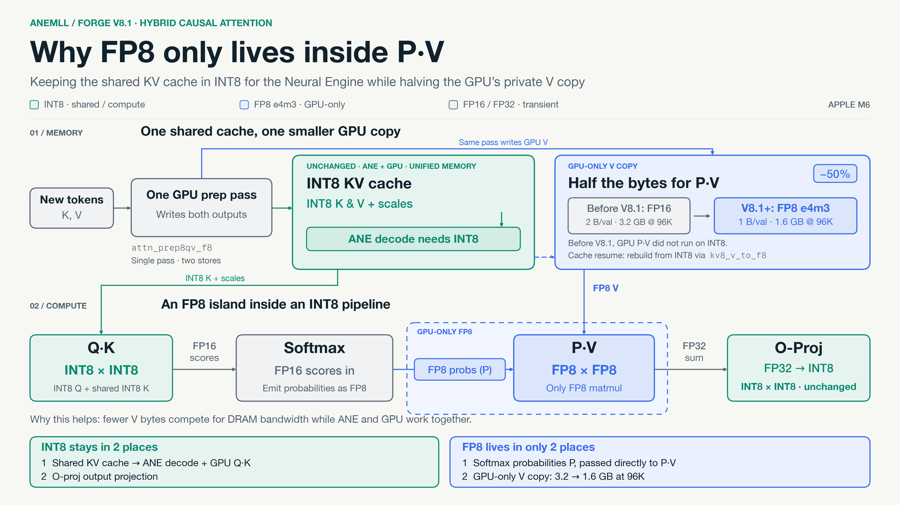

*Where FP8 sits in V8.1's attention. The KV cache shared with the Neural Engine stays INT8, as do Q·K and the output
projection. The M6 GPU has no fast FP8 x INT8 multiply, so the prep pass that writes the INT8 cache also writes a
GPU-only FP8 copy of V (1.6 GB at 96K instead of 3.2). The softmax reads FP16 scores and writes FP8 probabilities, and
P·V runs FP8 x FP8, about twice the FP16 matrix rate.*

**9. An on-chip scratch buffer for the Q·K write-back (V8.2, `QKE=tg`, served 19 Nov).** Q·K's multiply leaves its
results in registers, arranged the way the matrix hardware produces them rather than by row. The kernel used to write
each score straight from there to main memory, 2 bytes at a time and spread over many rows, so the GPU sent many mostly
empty memory blocks. `attn_qk8isk_tg` first copies the results into a 16 KB scratch buffer in on-chip memory, in row
order. It then writes each row out in full contiguous pieces, applying the query and key scales on the way. The
arithmetic and its order are unchanged. Q·K at 95K goes from 6.74 to 5.75 ms per call, and the output is
bit-identical. End to end: +1.5% at 32K, +1.6% at 64K, +2.4% at 95K, with the last-token logits identical
(KL 0).

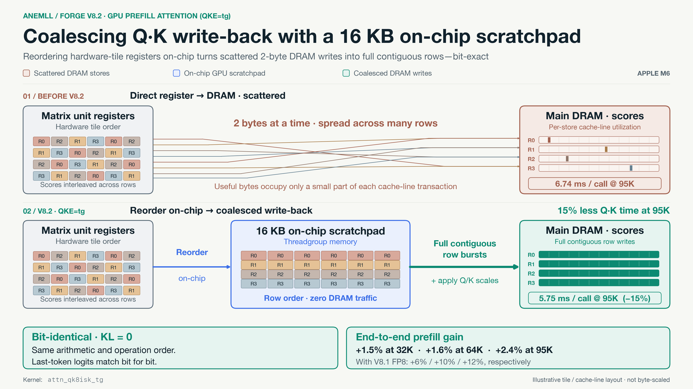

*How V8.2 writes the Q·K scores. Before, each score went from the matrix unit's registers straight to main memory, 2
bytes at a time across many rows. With `QKE=tg` the tile is first reordered into rows in 16 KB of on-chip threadgroup
memory, then written as full contiguous rows with the scales applied. Q·K drops from 6.74 to 5.75 ms per call at 95K,
bit-identical. The tile and cache-line layout is illustrative.*

**Together,** V8.1 and V8.2 add about 6% at 32K, 10% at 64K and 12% at 95K over the V8 kernels. That matches the gap
between V8 (16 Nov) and V8.2 in the 19 Nov run.

## How we optimized decode

**How decode works here (V8).** Decode uses speculative decoding: a small drafter (DFlash2) proposes 7 tokens, and the
27B target checks them in one 8-row verification call. Accepted tokens cost one cycle together. The verification takes
85 to 90% of the cycle, and it runs on the Neural Engine.

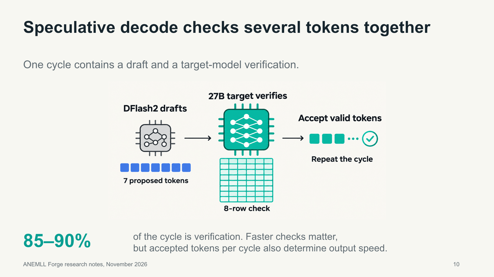

*Speculative decoding: the drafter proposes 7 tokens and the target checks them in one 8-row verification, 85 to 90% of the cycle.*

**The problem past 64K.** A Neural Engine program has fixed shapes, so its attention runs over the whole context entry
it was compiled for (8K, 16K, 32K, 64K or 96K), not over the tokens actually used. One verification step costs 85 ms in
the 16K entry and 122 ms in the 96K entry. A 65.6K-token conversation already runs in the 96K entry, and before V8 it
decoded 8% slower than Splash 1.3.2, whose GPU attention follows the real length.

**SPLIT+GPU (V8).** We split each verification step around the 16 full-attention layers. The Neural Engine runs
everything up to an attention layer's query, key and value projections; the GPU runs the attention over the actual KV
history; the Neural Engine finishes that layer and starts the next one in the same call. Everything else (the 48
DeltaNet layers, every FFN, every projection) stays on the Neural Engine. The Neural Engine parts bind no KV cache and
no mask, so **one compiled program serves every context length**: a 131K-token context ran a verification step in
139 ms with no recompile.

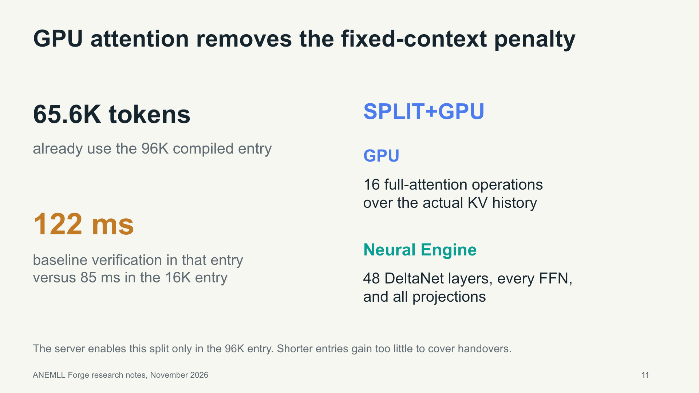

*SPLIT+GPU: past 64K the attention over the actual KV history moves to the GPU; the rest of the verification stays on the Neural Engine.*

**The kernel (V8; limit measured in V8.2).** Our first decode-attention kernels reached only about 35 GB/s: decode has
eight query rows, and the kernels walked their keys in sequence. The tuned kernel multiplies INT8 queries by INT8 keys
into INT32 scores, keeps the softmax in FP32 and multiplies FP16 probabilities by INT8 values. It splits the keys into
2,048-key chunks, runs three threadgroups of 16 query rows per KV head and chunk (each KV head serves 48 rows: 6 query
heads times 8 positions) and keeps the scores in registers. It reads 127 GB/s back to back.

In V8.2 we checked what limits it. The key side, the INT8 Q·K pass through the matrix units, takes 90% of the
key-side time and streams the keys at about 120 GB/s, below the 156 GB/s of a plain read; the value side streams about
150 GB/s. So the FP8 value product that pays in prefill gains nothing here: 0% on one layer, and the verification step
1.2% slower end to end. A key-major key layout (17 to 18% slower) and more, smaller threadgroups (7 to 21% slower) lose
too.

**Bandwidth.** On this M6 (170 GB/s peak) a plain GPU read streams 156 GB/s and the split's Neural Engine calls 121
GB/s; running both at once reaches 164 GB/s. Decode is close to the memory wall. In V8 the kernel reached only about
90 to 100 GB/s in the server, and every hand-over between the two units cost about 0.65 ms. The cause turned out to be
mostly the GPU's clock: between the Neural Engine calls the GPU sits idle, and its power controller ran the short
attention bursts at 502 to 874 MHz instead of 1,735.

**The GPU keep-alive (V8.1, served 18 Nov).** The power controller raises the GPU's clock only after 10 to 20 ms of
near-continuous work, and a split verification step gives it 16 attention calls of 1 to 2 ms between Neural Engine
calls of about 5 ms. Pre-warming, periodic kicks, thread priorities and the private deadline calls did not help. What
works is keeping the GPU busy:
- **How:** during split steps, a second command queue runs one simdgroup in short serial dispatches (20 µs each, 250
  per command buffer). That holds the GPU at 1,735 MHz.
- **When:** it stops 60 ms after the last split step (`DEC_KA_HOLD_MS=60`, which covers the draft), so an idle server
  pays nothing. A switch file turns it off without a restart.
- **Output:** it changes nothing in the kernels or their output.

Measured in the server at 66K tokens, with alternating turns, the medians of 4 turns each:

| keep-alive | cycle ms | verification ms | GPU attention ms per step | GPU clock | GPU + CPU + Neural Engine W | J per cycle |
|---|---|---|---|---|---|---|
| off | 150 | 136.1 | 29.9 | 891 MHz | 8.36 | 1.25 |
| on | **133** | **119.1** | **19.2** | 1,735 MHz | 11.02 | 1.46 |

- **Speed:** the cycle drops 11%. At about 92K one turn measured the verification step at 133.9 ms, against 143 to 149
  without the keep-alive.
- **Cost:** +2.7 W on the three units (+2.0 W on the GPU), and 17% more energy per cycle.
- **Where it runs:** only with the split verification, which means the 96K entry (prompts above about 65.2K tokens).
  Below that the GPU has no decode work, so decode at 2K to 64K is unchanged by it.
- **Caveat:** the behavior is a clock-management heuristic of macOS, so it needs a check after every macOS update.

**Why Splash needs no keep-alive.** Splash runs its whole decode on the GPU, one kernel after another, at 38 to 40 W
above idle, so its GPU never waits long enough to clock down or sleep. The hybrid's GPU in the split verification works
the opposite way: 16 attention bursts of 1 to 2 ms per step, separated by Neural Engine calls of about 5 ms, and idle for
about 110 to 120 ms of each 133 to 150 ms cycle (the Neural Engine calls, the hand-overs and the draft). It never gets
the 10 to 20 ms of continuous work the power controller needs before it raises the clock. In prefill neither engine has
this problem: both keep the GPU busy the whole time (the hybrid's GPU is 96 to 100% active at 1,735 MHz from 8K up). We
have not sampled Splash's clock; its decode power fits a GPU that stays busy.

**Result.** SPLIT+GPU (V8) took the decode cycle from 153 to 141 ms at 64K and from 155 to 149 ms at 95K. The
keep-alive (V8.1) took it to 133 ms at 66K and 142 to 146 ms at 96K. Against Splash 1.7.0 at 96K, V8.2 runs a 144 to
146 ms cycle against 155 ms, accepting 6.40 tokens per cycle against 6.9, so decode is about even: 45.3 against 44.4
tokens per second.

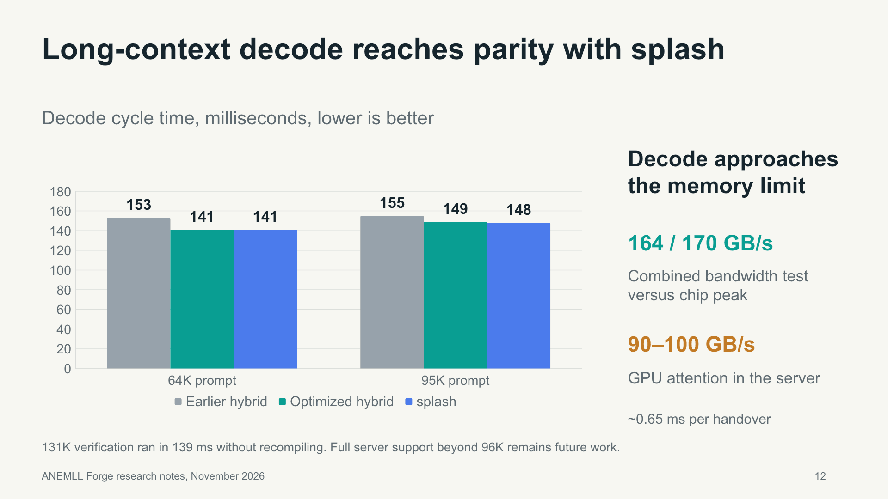

*V8-era figure (17 Nov): the decode cycle at 64K and 95K before SPLIT+GPU, with it, and on Splash 1.3.2, before the
V8.1 keep-alive. With the keep-alive the cycle is 133 ms at 66K and 142 to 146 ms at 96K.*

## Decisions we made

1. **Split by layer type, not by layer range or by tensor (V8).** Our first hybrid ran contiguous layer ranges on each
   unit (486 tokens per second at 8K, about Splash 1.3.2's speed). Mixers on the Neural Engine with FFNs on the GPU was
   GPU-bound; splitting each matrix product across both units needs a sync per product. The layer-type split won on
   arithmetic and in practice.
2. **Read the Neural Engine's compiled weights in place (V8).** This is what makes the hybrid fit in 32 GB, and it is
   also why it needs System Integrity Protection off (below). We accepted that for research.
3. **Core AI for the Neural Engine, our own Metal engine for the GPU (V8).** Core AI's own GPU path was far too slow
   for the GPU half: 89.5 ms for one FFN call (our Metal engine: 4.6 ms), 438 ms for a DeltaNet mix, and 118 s to load
   a chunk while expanding its weights in memory.
4. **INT8 keys with FP8 values on the GPU for prefill (V8.1).** The all-INT8 cache is lossless but 4 to 6% slower at
   64K and above. V8 kept an FP16 value copy (3.2 GB at 96K); V8.1 made it FP8 (1.6 GB), up to 10% faster at a mean KL
   of 1e-3.
5. **SPLIT+GPU only in the 96K entry (V8), with the keep-alive (V8.1).** In the 16K and 32K entries the split is 8 to
   17% slower and in the 64K entry about even, because the Neural Engine's own attention is cheap there and each
   hand-over costs 0.65 ms. Packages of eight layers let one call finish an attention layer and start the next, which
   saves a hand-over per pair.
6. **Measured in V8, kept out of the server:** runtime-INT8 FFNs on the Neural Engine (+6 to 10% at 6K to 16K, but no
   room in memory at 64K and above), DeltaNet mixers on the Neural Engine (+2 to 3% at 64K and above, worse below),
   switching attention projections by position (+0.5%).
7. **Rejected for decode in V8, all measured:** attention on both units split by key range (about 1 ms per step), FP8
   probabilities (no gain, twice the error), single-simdgroup register softmax (2.7 to 4.4 times slower), prefetching
   the next key/value tile (8 to 27% slower wherever we placed it), double buffering (86% slower), spin waits and GPU
   warm-up kicks (they slow the Neural Engine call), and Core AI's compute streams (they do not order Neural Engine and
   GPU work on macOS 27.3).
8. **Rejected in V8.1 and V8.2 (18 and 19 Nov), all measured:**
   - **FP8 x FP8 for the value product in decode attention:** 0% on one layer and the verification step 1.2% slower
     end to end. The key side limits decode attention, not the values.
   - **An INT8 FFN on the Neural Engine** (the 3-bit palette as INT8 codes, INT8 activations): prefill 2 to 3% slower
     at every length because of DRAM contention, with as much added KL again as FP8 values cost.
   - **The DFlash2 drafter on the GPU:** the draft needs the verification's result, so nothing can overlap. Run in
     sequence it would save at most about 1 ms per cycle, and forced to overlap it slows the verification. Its body
     takes 6.5 ms on the Neural Engine.
   - **256-row DeltaNet calls:** 8% slower end to end at 4K. Weight traffic is not what limits the DeltaNet matrix
     products, and the coupled schedule costs overlap.
   - **Tree verification wider than 8 rows on the Neural Engine:** 16 and 32 rows cost 26–39% and 87–116% more than chain8 in a four-layer probe. Choosing among 8/16/32 rows projected only 0.3–1.6% over fixed tree8 on the sampled set of greedy requests.
   - **Eight-row tree, 19 Nov projection.** On 12 low-acceptance greedy requests (964 cycles), seven dynamic nodes gave 3.348 vs 3.064 tokens per verify. Scaling the four-layer graph cost projected +4.5–4.9% decode throughput. In two later 36-request sampled benchmark blocks, the served tree gained 8.5% and 10.2% in pooled client throughput over chain8. The tool-agent subset lost 1.6% and 3.9%. [Served results and width measurements](TREE_VERIFY.html#fig-3)
9. **A thinking budget for effort "medium" (V8).** Our server closes the model's thinking at 6,144 tokens with Qwen's
   own budget phrase; Splash 1.3.2 has no cap by default. On the graded coding task the cap cost nothing (1,373 of 1,373
   either way) and saved a 14-minute first turn.
10. **Keep it on a research branch.** It needs system changes no release should ask for.

## Research environment restrictions: why it needs SIP off and root permission for weights

Core AI is not designed to run one model on the Apple Neural Engine and the GPU at the same time. It runs a model on
either unit, but it gives the GPU no way to use the weights the Neural Engine already holds, and its own GPU path was
far too slow for the hybrid's GPU half (decision 3). That doesn't mean Apple won't support this in the future. For
research, we work around it: we turn SIP off and let our GPU engine read the Neural Engine's compiled program (its
HWX file) directly, after a one-time root permission grant.

What that involves: macOS compiles each Core AI package for the Neural Engine the first time it loads, and keeps the
result, `model.hwx`, in `/Library/Caches/com.apple.aned/<macOS build>/ModelAssetsCache/`. The hybrid maps the weights
inside those files into the GPU's memory, read-only and without a copy (10.8 GiB), so the model's weights exist only
once; a second copy would not fit on a 32 GB Mac. Two protections stand in the way:

- **Root permission, once.** The cache directory belongs to root with mode 700, so a normal user cannot open it. One
  `sudo chmod +a` gives your user read access. Nothing is ever written to the cache.
- **SIP off.** The cache also carries macOS's `datavault` flag, which System Integrity Protection enforces even against
  root: with SIP on, not even sudo can read it. SIP has to be disabled from macOS Recovery, which lowers the security
  of the whole Mac, so use a dedicated research machine.

One more consequence: the GPU tables point into those compiled files and match only the M6 compiler's output on
macOS 27.3. They are rebuilt after every recompile (a macOS update or a cache purge), and other chips are not
supported. Commands and details: [Requirements: root and SIP](README.md#requirements-root-and-sip).

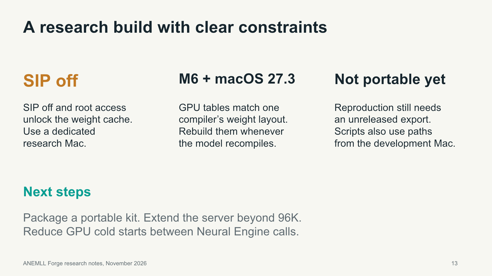

*The research build's constraints and next steps. V8-era figure: the export it calls unreleased is public now (see
"Today's limits" below), and the V8.1 keep-alive handles the GPU's cold starts.*

## Reproduce it

Everything is on the ANEMLL Forge research branch
[`v8-gpu-ane-prefill`](https://github.com/Anemll/anemll-forge/tree/v8-gpu-ane-prefill/research/v8_prefill) (code, build scripts, notes and every raw result; the state this article
describes is commit `fa224c9`). The build itself is on Hugging Face. The steps, in order:

| step | where |
|---|---|
| 1. Read the requirements: M6, 32 GB, macOS 27.3, SIP off and one read grant on the compiled weights | [DEPLOY.md, section 2](https://github.com/Anemll/anemll-forge/blob/v8-gpu-ane-prefill/research/v8_prefill/hf/DEPLOY.md#2-requirements) and [Requirements: root and SIP](https://github.com/Anemll/anemll-forge/blob/v8-gpu-ane-prefill/research/v8_prefill/README.md#requirements-root-and-sip) |
| 2. Download the build, the GPU-table kit, the drafter, the model files and a code snapshot | Hugging Face [anemll/anemll-forge-qwen3.8-27B-V8-96K](https://huggingface.co/anemll/anemll-forge-qwen3.8-27B-V8-96K) (`coreai/m6-96k-dec8ts`: tree8 + sliced; `gpu/w_dec8ts`: the table kit); [DEPLOY.md, section 3](https://github.com/Anemll/anemll-forge/blob/v8-gpu-ane-prefill/research/v8_prefill/hf/DEPLOY.md#3-download) |
| 3. Set up Python and the Core AI Swift bridge | [main README, section 1](https://github.com/Anemll/anemll-forge/blob/v8-gpu-ane-prefill/README.md#1-set-up-the-inference-environment); [DEPLOY.md, section 4a](https://github.com/Anemll/anemll-forge/blob/v8-gpu-ane-prefill/research/v8_prefill/hf/DEPLOY.md#4-build-on-the-mac) |
| 4. Compile the packages for your Neural Engine, build the GPU engine libraries | [DEPLOY.md, section 4](https://github.com/Anemll/anemll-forge/blob/v8-gpu-ane-prefill/research/v8_prefill/hf/DEPLOY.md#4-build-on-the-mac): `forge.py compile`, [`pipe/engine/build_engines.sh`](https://github.com/Anemll/anemll-forge/blob/v8-gpu-ane-prefill/research/v8_prefill/pipe/engine/build_engines.sh) |
| 5. Install the GPU tables (or rebuild them from the export) | [DEPLOY.md, section 5](https://github.com/Anemll/anemll-forge/blob/v8-gpu-ane-prefill/research/v8_prefill/hf/DEPLOY.md#5-gpu-tables): [`pipe/gpu_tables_kit.py`](https://github.com/Anemll/anemll-forge/blob/v8-gpu-ane-prefill/research/v8_prefill/pipe/gpu_tables_kit.py), [`pipe/build_gpu_tables.sh`](https://github.com/Anemll/anemll-forge/blob/v8-gpu-ane-prefill/research/v8_prefill/pipe/build_gpu_tables.sh) |
| 6. Start the server (OpenAI API on port 8765) | [DEPLOY.md, section 6](https://github.com/Anemll/anemll-forge/blob/v8-gpu-ane-prefill/research/v8_prefill/hf/DEPLOY.md#6-deploy): [`hf/serve_v8_96k.sh`](https://github.com/Anemll/anemll-forge/blob/v8-gpu-ane-prefill/research/v8_prefill/hf/serve_v8_96k.sh). On the development M6: [`pipe/v8_server_dec8_qk.sh`](https://github.com/Anemll/anemll-forge/blob/v8-gpu-ane-prefill/research/v8_prefill/pipe/v8_server_dec8_qk.sh). Options and request flow: [the server notes](https://github.com/Anemll/anemll-forge/blob/v8-gpu-ane-prefill/research/v8_prefill/pipe/V8_SERVER.md) |
| 7. Check it: banners, a 2-request smoke with a fixed output checksum, memory over context switches | [DEPLOY.md, section 7](https://github.com/Anemll/anemll-forge/blob/v8-gpu-ane-prefill/research/v8_prefill/hf/DEPLOY.md#7-test): [`bench_tree/tree_bench.py`](https://github.com/Anemll/anemll-forge/blob/v8-gpu-ane-prefill/research/v8_prefill/bench_tree/tree_bench.py) with [`smoke_2k_v1.json`](https://github.com/Anemll/anemll-forge/blob/v8-gpu-ane-prefill/research/v8_prefill/bench_tree/smoke_2k_v1.json), [`serve_t/memleak_alt.py`](https://github.com/Anemll/anemll-forge/blob/v8-gpu-ane-prefill/research/v8_prefill/serve_t/memleak_alt.py) |
| 8. Point Pi at it, with live tok/s and TTFT | [DEPLOY.md, section 7b](https://github.com/Anemll/anemll-forge/blob/v8-gpu-ane-prefill/research/v8_prefill/hf/DEPLOY.md#7b-pi-coding-agent-with-live-tps--ttft): [`examples/pi/install_pi_v8_96k.py`](https://github.com/Anemll/anemll-forge/blob/v8-gpu-ane-prefill/examples/pi/install_pi_v8_96k.py), [the TPS footer](https://github.com/Anemll/anemll-forge/blob/v8-gpu-ane-prefill/examples/pi/extensions/TPS_PI_EXTENSION.md) |
| Steps 1 to 8 as one script, for coding agents | [AGENTS.md](https://github.com/Anemll/anemll-forge/blob/v8-gpu-ane-prefill/research/v8_prefill/hf/AGENTS.md) and [`hf/agent_deploy.sh`](https://github.com/Anemll/anemll-forge/blob/v8-gpu-ane-prefill/research/v8_prefill/hf/agent_deploy.sh) (stages with exit codes; it stops where a person must act) |
| Measure: hybrid against Splash 1.7.0 | [`scripts/m6_compare_bench.py`](https://github.com/Anemll/anemll-forge/blob/v8-gpu-ane-prefill/scripts/m6_compare_bench.py) and [`compare_cool.sh`](https://github.com/Anemll/anemll-forge/blob/v8-gpu-ane-prefill/research/v8_prefill/results/19nov/splash170_cool/compare_cool.sh) (speed, power, temperatures). The V8 baseline: [`pipe/unit/cmp_bench.py`](https://github.com/Anemll/anemll-forge/blob/v8-gpu-ane-prefill/research/v8_prefill/pipe/unit/cmp_bench.py), [`splash132/cmp_96k.sh`](https://github.com/Anemll/anemll-forge/blob/v8-gpu-ane-prefill/research/v8_prefill/splash132/cmp_96k.sh), and [`bench/cron/`](https://github.com/Anemll/anemll-forge/tree/v8-gpu-ane-prefill/research/v8_prefill/bench/cron) (the coding prompt and its hidden grader) |
| Measure: tree8 and the sliced entries | [`bench_tree/`](https://github.com/Anemll/anemll-forge/tree/v8-gpu-ane-prefill/research/v8_prefill/bench_tree) (prompt sets, `tree_bench.py`, `run_arm.sh`), [`serve_t/tree_sampled_ab.sh`](https://github.com/Anemll/anemll-forge/blob/v8-gpu-ane-prefill/research/v8_prefill/serve_t/tree_sampled_ab.sh), [`serve_t/slice_ab4.sh`](https://github.com/Anemll/anemll-forge/blob/v8-gpu-ane-prefill/research/v8_prefill/serve_t/slice_ab4.sh); the paper: [TREE_VERIFY.md](https://github.com/Anemll/anemll-forge/blob/v8-gpu-ane-prefill/research/v8_prefill/TREE_VERIFY.md) |
| Rebuild the build from the export | [Build chain](https://github.com/Anemll/anemll-forge/blob/v8-gpu-ane-prefill/research/v8_prefill/README.md#build-chain) (steps 1 to 7) and [DEPLOY.md, section 8](https://github.com/Anemll/anemll-forge/blob/v8-gpu-ane-prefill/research/v8_prefill/hf/DEPLOY.md#8-rebuilding-the-build-itself) |
| Raw results of every run | [`results/`](https://github.com/Anemll/anemll-forge/tree/v8-gpu-ane-prefill/research/v8_prefill/results), one folder per day with an index (e.g. [22 Nov](https://github.com/Anemll/anemll-forge/blob/v8-gpu-ane-prefill/research/v8_prefill/results/22nov/README.md)) |

**Today's limits.** Every input is public, and since 22 Nov the deployment path is scripted
([hf/DEPLOY.md](https://github.com/Anemll/anemll-forge/blob/v8-gpu-ane-prefill/research/v8_prefill/hf/DEPLOY.md)): a launcher that takes the download folder, our GPU tables shipped with a sha256 of
each compiled Neural Engine program (when your compile matches, they install in seconds; on the development M6 the
installed tables are byte-identical to the served ones), and a Pi installer. The tables point into your own compiled
programs, which is why SIP must be off. When your compile differs (another macOS build), they are rebuilt from the
public release 0.2 export in
[anemll/anemll-quantized-qwen3.8-27b-for-CoreAI](https://huggingface.co/anemll/anemll-quantized-qwen3.8-27b-for-CoreAI)
(`export/release_vq3pA_mixh_s600_k1_mat/`, byte-identical to the files this build was made from, and the small tensors
in `model/`), which needs the builder environment (torch and the Core AI Python tools). Still missing: the path has
not been tested on a second Mac, and the research scripts outside it use the development machine's absolute paths
(listed in the [research README](https://github.com/Anemll/anemll-forge/blob/v8-gpu-ane-prefill/research/v8_prefill/README.md#layout)).

## Lessons that carry over

- **Fewer, bigger Neural Engine calls.** The fixed per-call gap dominates small calls.
- **Never call one Core AI function from two threads at once.** The outputs go wrong without an error.
- **Fast Neural Engine INT8 forms can be silently wrong.** Two matrix shapes we tried computed wrong results with
  nothing to signal it; check every new form against a host reference.
- **Measure the pair, not each unit.** On the M6 the Neural Engine and the GPU slow each other down; their separate
  ceilings do not add up.
- **Find the shared resource before designing around it.** The V8 power-limit guess was wrong; V8.1's bandwidth
  telemetry showed DRAM, and the levers became bytes.
- **Weights once.** On a 32 GB Mac any duplicate of a 27B model's weights decides what fits.
- **Compare only back-to-back or interleaved runs, started cool.** The Neural Engine loses 30 to 45% after minutes of
  continuous work, and a hot machine cost the hybrid 11% of its 16K prefill.
- **Short GPU bursts run at a low clock.** Between Neural Engine calls the GPU's clock falls; a tiny keep-alive holds
  it up for 2 to 3 W.
- **Prove which code ran.** A shell that silently ignored our environment switches once made a whole batch of kernel
  variants measure the same kernel; every variant now prints a checksum of its output, and every server run prints a
  banner with the hashes of its engines.

## What is next

- **Fewer bytes in long-context attention.** Today each query head re-reads its key/value head. A kernel that serves
  all six query heads from one pass would read about 0.25 to 0.3 GB per call at 60K instead of 1.76 (an estimate).
- **Larger FFN blocks on the Neural Engine,** so its weights are read fewer times per token.
- **Runtime-INT8 FFNs on the Neural Engine at 6K to 16K** (+6 to 10% in V8), once memory allows. The compiled INT8 FFN
  of V8.2 was slower.
- **DeltaNet projections on the Neural Engine at long context** (a V8 estimate of about 520 tokens per second at 64K).
- **Decode acceptance.** On 423 greedy code cycles, replay gave 7.057 tokens per verify for the chain, 7.111 for the dynamic tree and 6.314 for a fixed six-token spine with one alternate first token. The remaining correctness test compares both branches with independent chains through the output head and then checks the next token after committing a branch. [Fixed-spine replay](TREE_VERIFY.html#5-4-a-six-token-spine-with-one-root-sibling) · [Correctness tests](TREE_VERIFY.html#6-correctness-and-reproducibility)
- **Serving 128K:** the split already runs there without a recompile; the server needs its key/value cache and prefill
  extended past 96K.

Code, numbers and every rejected variant: [README.md](README.md), [PREFILL_RESEARCH.md](PREFILL_RESEARCH.md),
[pipe/unit/DECODE_GPU_ATTENTION.md](pipe/unit/DECODE_GPU_ATTENTION.md), the contention follow-up
[ARTICLE_CONTENTION_M6.md](ARTICLE_CONTENTION_M6.md), and the 18 and 19 Nov logs in
[results/18nov/](results/18nov/README.md) and [results/19nov/](results/19nov/README.md).

## About the figures

- **New in version 2:** from the V8.2 run of 19 Nov, the prefill and decode overview, prefill throughput (replaces
  version 1's prefill chart, `img/06-prefill-throughput.png`), decode throughput, and net energy saved; and two
  diagrams: where FP8 sits in V8.1's attention (`img/v2/attn-fp8-island.png`, step 8) and V8.2's on-chip scratch
  buffer for the Q·K write-back (`img/v2/attn-qke-tg-scratchpad.png`, step 9).
- **V8-era figures still showing version 1 numbers, awaiting a refresh:** why long prompts feel slow (64K prefill
  time), the shared performance ceiling (its "likely cause" panel), accelerator activity (busy shares), decode
  performance (cycle against Splash 1.3.2, before the keep-alive), and the research constraints (next steps).
- **Unchanged:** one model and two accelerators, the prefill split, the pipeline, the shared weights, speculative
  decoding, and SPLIT+GPU.
