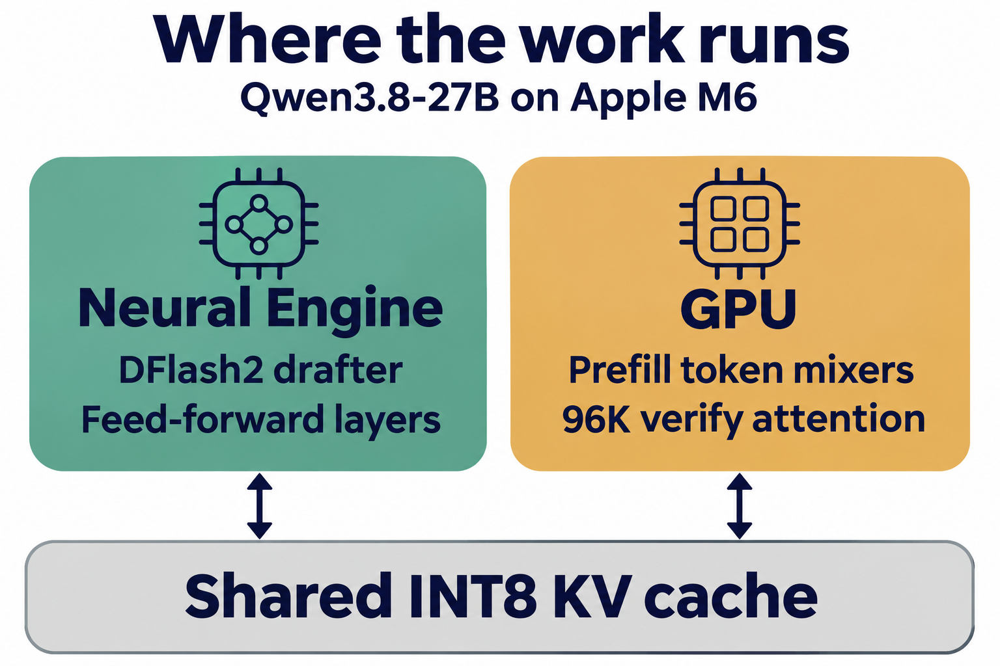
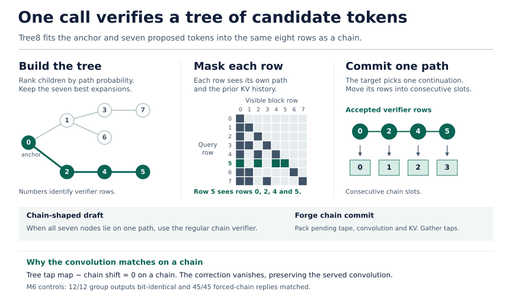
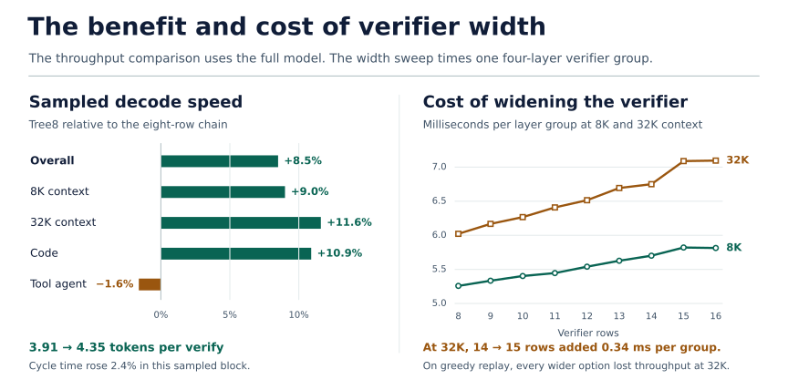
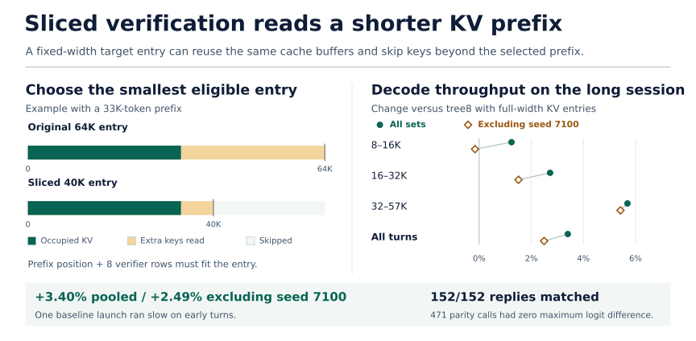

# Tree Speculative Decoding on a Split ANE + GPU Target: Qwen3.8-27B on Apple M6

ANEMLL forge research notes, 20 to 22 November 2026. Every number below is measured on the M6 and logged in
`research/v8_prefill/results/{19,20,21,22}nov/README.md` unless marked as a projection.

## Abstract

We serve Qwen3.8-27B (64 layers: 48 Gated DeltaNet, 16 full attention; 3-bit MLP weights, INT8 KV) on an Apple M6 with
the feed-forward networks on the Neural Engine (ANE) and the token mixers split between the ANE and the GPU. Decoding
uses a DFlash2 block drafter that proposes 7 tokens per cycle on the ANE, verified by an 8-row target call. We turn the
drafter's 7 proposals into a dynamic tree of 7 nodes inside the same 8 verify rows, so the verify width, and therefore
its cost, stays that of the chain. Three pieces make this work on a fixed-shape accelerator: (1) ancestor-mask inputs
on the existing 8-row verify programs, (2) an exact tree form of the DeltaNet short convolution (`corrx0`, bit-identical
to the chain under chain masks, +4.5% per layer group), and (3) a commit step that compacts the accepted path back into
rows 0..k, so the rest of the runtime only ever sees a chain. Sampled requests use a lossless child-by-child rejection
rule. On the user's real workload (a Pi coding-agent session, sampled at temperature 1.0) tree8 is +8.5% tok/s over the
chain; greedy gains are +1.9 to +6.5% on realistic 2K-64K prompts. Wider trees (16 or 32 rows) do not pay on the ANE,
because DeltaNet's per-row solve and the tree conv grow with the width. A final change, sliced verify entries that
attend only to the occupied KV prefix, adds +2.5% on the long agent session at identical outputs. Both are served.

## 1. Introduction

Speculative decoding [1, 2] hides the cost of a large target model behind a cheap drafter: the drafter proposes k
tokens, the target scores all of them in one call, and an acceptance rule keeps a prefix. On a GPU the verify call's
cost grows slowly with the number of rows, so many systems verify a tree of candidates instead of one chain
[3, 4, 5, 6, 7], including trees built from a block diffusion drafter's per-position distributions [10, 11].
Our target runs largely on the ANE, which executes precompiled programs of fixed shape, and whose cost per extra row is
not small for this hybrid model. The questions were:

- Can a tree help when the verify width cannot grow?
- What does a wider verify really cost on the ANE, and where does the cost go?
- Can the tree be exact (same outputs as the chain when the tree is a chain), so that served replies stay reproducible?

## 2. System

### 2.1 Target model and placement (V8)

- **Model:** Qwen3.8-27B, 64 layers (48 Gated DeltaNet, 16 full attention at layers 3, 7, ..., 63), hidden 5,120,
  vocabulary 248,320. Release 0.2 weights: 3-bit vector-quantized MLPs, rank-64 FP16 residual factors on the mixer
  projections; an INT8 KV cache (KV8) shared by the ANE and the GPU.
- **Prefill (V8):** every FFN on the ANE, every mixer on the GPU (Metal), with a shared INT8 KV cache.
- **Decode verify (dec8 build):** 8 packages of 8 layers. Below 64K the verify is one ANE program per package. In the
  96K entry the verify is split per package: ANE `dva` (up to the attention projections), GPU attention (INT8 Q.K,
  online softmax, FP16 x INT8 P.V, the 8 new K/V rows written into the ANE's own KV segments), ANE `dvba`, GPU
  attention, ANE `dvb`. The split ANE programs bind no KV, so one program serves every context.
- **Memory bandwidth** (the shared resource): GPU streaming 156 GB/s, ANE split calls 121, both at once 164 of a
  170 GB/s peak.

**Figure 1. Hardware placement.** DFlash2 and the target feed-forward layers run on the ANE. The GPU handles token mixing during prefill and the attention operations of the split 96K decode verifier.

### 2.2 Drafter (DFlash2)

The drafter is DFlash2, a DFlash-style block drafter [9] conditioned on target features, derived from a public
checkpoint [19] and converted to Core AI for the ANE.

- 5 layers, 32 heads, conditioned on 5 target tap features (layers 5, 19, 33, 47, 61), drafting a block of 7 tokens
  per pass. LUT4 weights (Hadamard + GPTQ), on the ANE.
- A **candidate selector** (predecessor and successor codebooks, rank 256, top-16 candidates) scores each candidate
  token given its parent. The chain is the argmax child at each depth.
- Draft phase per cycle: 13.3 ms, of which 12.3 ms is ANE work (body 6.86, head 4.41, context 0.99 ms) and about
  1.0 ms host. A GPU twin of the drafter was slower under contention (13.3 to 14.5 ms against the ANE verify), so the
  drafter stays on the ANE.

### 2.3 Baseline: the 8-row chain

On a realistic prompt set (code, math, chat, 2K to 96K context) the served chain accepts 4.57 to 5.16 tokens per
verify. Code and math sit near the 7-draft cap (7.1 and 6.5 tok/verify); chat is at 2.4. The gap to the cap is where a
tree can help.

## 3. Method

### 3.1 Tree construction in 8 rows

Per cycle, from the anchor token (the last committed token):

1. Expand best-first by **path probability** (as in dynamic draft trees [5, 10]) under the selector score, `softmax(s_i(c | parent) / tau)` over the
   top `TOPC` children of each node (`TOPC = 4`; `tau = 1.5`, calibrated offline in results/20nov).
2. Stop at the anchor + 7 nodes. Rows are filled in pop order, which is topological.
3. If the 7 nodes form the chain, the cycle runs the served chain entry (policy `branched`); otherwise the tree entry.

Fixed tree shapes do not work here: 707 distinct shapes occur on the realistic set.

### 3.2 Tree verify entries

The tree entries (`t8_<ctx>k`, and `tdva` / `tdvba` in the split) are the served 8-row programs with two extra inputs
on the same weight constants, so they add no weight memory:

- **Ancestor mask:** each row attends to the KV history plus its ancestors only (in the split, the GPU attention
  applies the same per-row mask).
- **Depth positions:** RoPE at `p0 + depth`, not `p0 + row`.

### 3.3 DeltaNet in a tree

The 48 DeltaNet layers are recurrent, so a tree needs two things a chain gets for free.

- **Pending tape, not a state per row.** Gated DeltaNet [13] is computed chunkwise with the UT / WY form of the delta
  rule [14]. The verify keeps the block's DeltaNet rows (k / u / wk) and cumulative decay
  columns as a pending tape, and the in-block recurrence is a matmul over a mask input. With the ancestor mask in place
  of the causal one, each row sees only its own path, and no state is copied per branch. (The same design as Splash's
  DeltaNet tree handling [18].)
- **Exact tree convolution (`corrx0`).** DeltaNet's short causal conv must read each row's ancestors, not the
  previous rows.
  - A one-hot gather (`ctap @ rows`) was the first form. It is not exact on the ANE (rel 1.8e-3 per group) and flips
    near-ties.
  - The exact form keeps the served conv and adds one correction matmul: `[rows * w_t] (cdim x 44) @ D (44 x 8)`, with
    `D = ctap - shift` and the chain shift built in numpy as a constant.
  - Under chain masks it is bit-identical to the chain entry: 45 of 45 replies byte-identical, 2K to 96K. It costs
    +4.5% per group; tree verify is x1.024 to x1.039 the chain's cost.
  - Pitfall: an in-place `index_put` inside the traced forward produces ops the ANE will not run (the package falls
    off the ANE).

### 3.4 Acceptance

- **Greedy:** from the root, take the child whose token is the row's argmax, until none matches. The next token is the
  last accepted row's argmax.
- **Sampled (`TREE_SAMPLED=1`):** at each node, the chain's own rule child by child: accept child `c` with probability
  `r(c)`, where `r` is the row's sampling distribution with the rejected siblings removed and renormalized; if all are
  rejected, sample the next token from `r`. This is multi-candidate recursive rejection sampling [3, 8], so the output
  has the distribution of plain sampling. A one-child node makes exactly the chain's random draws. Checked against the release loop, including
  the RNG state.

### 3.5 Commit: back to a chain

After acceptance the accepted rows are moved to rows 0..k in place:

- every DeltaNet layer's pending tape (k / u / wk rows, cumulative columns) and conv rows;
- the new K / V rows (non-split: the entry's outputs; split: the cache rows the GPU wrote at `p0 + row`);
- the drafter's tap features.

Snapshots, the next call's commit and the V8 continuation prefill therefore see a chain of k + 1 rows, and nothing else
in the runtime changes.

**Figure 2. One tree verification cycle.** Row 0 holds the anchor. In this example the accepted path is 0 → 2 → 4 → 5. Compaction places those four rows in slots 0 through 3. The mask also governs the in-block DeltaNet recurrence, and the short convolution uses the same ancestry to select its taps.

### 3.6 Sliced verify entries (22 Nov)

A verify at position `p0` in the 64K entry still reads 64K keys. Sliced entries (`v8s_<w>k`, `t8s_<w>k`) bind the
same KV segment buffers but attend only to the first `w` keys. A call uses the smallest `w` with `p0 + 8 <= w`. The
served set is 24/40/48/56K, binding the 32K and 64K entries' KV. Sliced calls are bit-exact against the bigger entry
with the keys at or above `w` masked: 471 calls, max |logit diff| 0, KL 0.

## 4. Evaluation

### 4.1 Setup

- Apple M6, macOS 27.2 / 27.3. One model process on port 8765.
- **Prompt sets:** a realistic set (code, math, chat at 2K to 96K); an agent set (Pi-like code-agent turns); and a long
  Pi-like session (19 turns, 8.6K to 55.5K tokens, 512-token replies), greedy plus three sampling seeds at
  temperature 1.0 with thinking on.
- **Metric:** client-side decode tok/s, token-weighted. Arms are run ABBA, from fresh server launches, with the banner
  checked on every arm. Run-to-run noise of the served chain is about 4% tok/s at byte-identical outputs, so tree arms
  are compared on identical texts where possible (offline replay with measured costs) or across both orders.

### 4.2 Tree8 vs chain, greedy

| measurement | result |
|---|---|
| Realistic set, end to end (2K-64K rungs) | +1.9% to +6.5% tok/s |
| Like for like (chain's own texts, measured tree cost x1.024-1.039) | +0.9% to +3.5% by rung; chat +9% |
| Served 21 Nov: 2K / code / agent | 45.80 / 40.66 / 54.04 vs chain 42.74 / 39.46 / 54.48 tok/s |
| 2K, fresh-launch like for like | +5.1% (44.91 vs 42.74) |

Code and math gain little because their chains already accept close to 7 of 7.

### 4.3 Tree8 vs chain, sampled (the Pi workload)

Before `TREE_SAMPLED`, every temperature > 0 cycle went to the chain, so Pi (temperature 1.0) never used the tree.

| set | change |
|---|---|
| overall | **+8.5%** |
| 8K / 32K | +9.0% / +11.6% |
| code / agent | +10.9% / -1.6% |
| tok/verify | 3.91 -> 4.35 |
| ms per cycle | +2.4% |

Sampled gains exceed greedy ones. Our reading, not separately measured: sampled chains reject earlier, so a second
candidate at an early depth is worth more.

**Figure 3. Throughput and width cost.** Left, the first 36-request sampled block compares tree8 with chain8 and includes the tool-agent regression. Right, each point times a four-layer hardware probe. At 32K the step from 14 to 15 rows costs 0.34 ms per group. The wider full-model throughput estimates come from replay using these measured costs.

### 4.4 Sliced entries on the long session (22 Nov)

Served tree8 vs tree8 + sliced 24/40/48/56K, ABBA, 4 sets (greedy + seeds 7100/7200/7300), 152 replies:

| band | served | sliced | change (pooled) |
|---|---|---|---|
| 8-16K | 39.60 | 40.09 | +1.24% |
| 16-32K | 36.15 | 37.13 | +2.72% |
| 32-57K | 29.64 | 31.33 | +5.69% |
| all | 34.65 | 35.82 | +3.40% |

One served set ran about 11% slow on its first 7 turns, below any sliced entry. Without that seed the overall gain is
**+2.49%** (order a +2.11%, order b +2.86%). All 152 replies are identical. Tree cycle 111.4 -> 108.2 ms, chain cycle
107.0 -> 104.4 ms. Served since 22 Nov 11:15.

**Figure 4. Slicing the KV prefix.** At a 33K prefix, the 40K entry covers all eight new rows. The right panel compares the four-entry sliced build with the full-width tree8 build. The pooled speedup is 3.40%, or 2.49% after excluding seed 7100, whose baseline had seven unusually slow early turns. All 152 paired replies matched.

## 5. What did not work

### 5.1 Wider trees on the ANE

Cost of one layer group's verify, relative to the 8-row chain (8K-64K entries):

| width | cost |
|---|---|
| tree8 | +4.6% to +5.3% |
| tree16 | +26% to +39% |
| tree32 | +87% to +116% |
| 16-row chain | x1.085 at 8K, x1.17 at 32K, x1.27 at 64K |

Where a wider verify's cost goes:

- **FFN:** nearly free (+2% / +4% at 16 / 32 rows).
- **DeltaNet UT solve:** +27% / +130% for 3 layers at 16 / 32 rows. Block forward substitution cuts 32 rows by 40%.
- **Tree conv taps:** the largest term (+0.66 / +1.58 ms per group).
- **Attention at long context:** the score passes.

Measured widths 8 to 16: no width beats tree8 by more than 1.6% greedy, and all lose at 32K. Splash 1.7.0
[18] (GPU-only) gets +17-22% tok/cycle from its 16-row tree at 0-2% cycle cost. That width is cheap on a GPU and is not
cheap on this ANE target.

### 5.2 Other policies and drafters

| idea | result |
|---|---|
| Per-cycle tree / chain choice by a cost model (`TREE_POLICY=dink`, a Dinkelbach-style ratio rule [21]) | long session -5.9% (-10.8% at 32-57K): the running-mean chain estimate is inflated by confident cycles |
| Per-cycle size selection 8/16/32 (offline) | +0.3% to +1.6%; oracle only +5-9% |
| Fork-aware ranking, tau sweeps | no gain; served tau 1.5 already best |
| Prompt lookup (n-gram) drafts [17] | full-file code edits +101%; gated (`yield:1.25`) code +92% greedy / +27% sampled; long Pi session: no gate gains at 3 seeds. Off for Pi |
| Lookup + drafter tree combined | loses: it pays for both the drafter and the tree verify |
| JetSpec++ [12] (B16 drafter) by replay | x1.42 to x1.81 tokens per round, but as a serial ANE drafter 12-46% slower end to end. Parked until drafting can overlap the verify |
| Drafter on the GPU | slower under DRAM contention (13.3-14.5 ms vs 12.3 ms ANE) |

## 6. Correctness and reproducibility

- **Identity criterion.** A tree changes the cycle split, so branched tree8 cannot be token-identical to the chain. A
  chain-only control with a different cycle split keeps only 20 of 45 replies identical; branched tree8 keeps 23 of
  45. We therefore require: chain-shaped cycles through the tree entry are bit-identical (`corrx0`: 45/45), and
  sampled outputs follow the plain-sampling distribution.
- **Used vs fresh server.** Replies on a used server differed from a fresh one. The cause was the drafter's context
  ring, which snapshots restored by position only: a cold request rewrote those slots, and the next restore drafted
  from the wrong rows. Fix (`DRAFT_RING_SNAP=fix`, served): copy the visible ring slots into the snapshot.
- **Leftover.** Stale KV rows past the position still leak into some replies (fixed by `COLD_SCRUB=kv`, 2-8 ms, not
  served because it changes replies).
- **ANE pitfall.** Two simultaneous runs of the same ANE function with different bindings corrupt outputs silently.
  The schedule serializes them per function.

## 7. Limitations and next steps

- The tree's gain is capped by the 8 rows. More tokens per cycle need a better drafter (JetSpec++-style blocks), not
  a wider tree, unless the ANE's per-row DeltaNet cost comes down.
- Tree verify adds 2-4% per cycle. The cost is the conv correction and the mask inputs, not the FFN.
- Gains are measured on one machine and one model pair. They are noisy at the 2-4% level, so every change was judged
  ABBA across both orders, with seeds pooled.

## 8. Related work

- **Speculative decoding.** Draft-then-verify with a lossless acceptance rule [1, 2].
- **Tree verification.**
  - SpecInfer [3] introduced token-tree verification with tree attention (our ancestor masks).
  - Medusa [4], EAGLE / EAGLE-2 / EAGLE-3 [5, 6] and Sequoia [7] build static or dynamic draft trees for GPU verifiers.
  - Recursive speculative decoding [8] studies sampling without replacement in trees.
  - Our setting differs in one constraint: the verify width is fixed at 8 rows by a precompiled ANE program, so the
    tree replaces the chain inside the same rows.
- **Block diffusion drafters and their trees.** Our drafter is a DFlash-style block drafter [9]. The closest prior art
  to our tree construction is DDTree [10], which builds a draft tree from one block diffusion pass and verifies it in
  one target pass. DForkTree [11] makes that tree fork-aware; our fork-aware ranking experiment (section 5.2) gave no
  gain in 8 rows. We implemented the tree independently on DFlash2's candidate selector and did not use code from [10]
  or [11]; the novel parts here are the fixed-width ANE verify, the exact tree conv for DeltaNet, and the commit step
  back to a chain.
- **Parallel drafting.** JetSpec [12] and JetSpec++ [12] draft larger blocks or trees with a learned head and
  self-refinement. We replayed JetSpec++'s published Qwen3.8-27B drafter on our target (section 5.2) and measured its
  cost on the ANE.
- **Linear attention in a tree.** Gated DeltaNet [13] and the chunkwise delta-rule algorithm [14] are the layers our
  verify must handle per path; the pending tape is our adaptation of that algorithm to ancestor masks.
- **Apple silicon engines.** Splash [18] (Inco AI) is the GPU + ANE reference we compared against throughout; its
  16-row tree motivated the width study, and its DeltaNet tree handling matches ours.
- **Quantization of the drafter.** GPTQ [15] with a Hadamard rotation [16].
- **Attention kernels.** The split verify's GPU attention is a flash-decoding style kernel [20].

## Acknowledgements

- The Qwen Team (Alibaba Cloud) for Qwen3.8-27B [22].
- The DFlash2 drafter is derived from ProCreations/Ternary-Bonsai-2-27B-DFlash2 [19] (Apache 2.0, upstream NOTICE
  preserved), with selector codebooks extracted from it; drafter parity uses the vendored DFlash reference code
  (MIT) [9].
- The JetSpec++ drafter, adapter and calibration used in the replay are the authors' published artifacts [12].
- Inco AI's Splash [18] served as the measured GPU + ANE reference (versions 1.3.x to 1.7.0).
- An outside review of the 21 Nov code found the empty-ring restore crash, the non-atomic 'sysk' restore and the
  split tree mask ordering (section 6), and corrected the lookup replay's row budget.
- The M6 ANE bot proposed several of the experiments in section 5 (fork-aware ranking, the cost-model policy, the
  lookup gates).

## References

1. Y. Leviathan, M. Kalman, Y. Matias. Fast Inference from Transformers via Speculative Decoding. ICML 2023.
   arXiv:2211.17192.
2. C. Chen, S. Borgeaud, G. Irving, J.-B. Lespiau, L. Sifre, J. Jumper. Accelerating Large Language Model Decoding
   with Speculative Sampling. arXiv:2302.01318, 2023.
3. X. Miao et al. SpecInfer: Accelerating Large Language Model Serving with Tree-based Speculative Inference and
   Verification. ASPLOS 2024. arXiv:2305.09781.
4. T. Cai et al. Medusa: Simple LLM Inference Acceleration Framework with Multiple Decoding Heads. ICML 2024.
   arXiv:2401.10774.
5. Y. Li, F. Wei, C. Zhang, H. Zhang. EAGLE: Speculative Sampling Requires Rethinking Feature Uncertainty (ICML 2024,
   arXiv:2401.15077) and EAGLE-2: Faster Inference of Language Models with Dynamic Draft Trees (EMNLP 2024,
   arXiv:2406.16858).
6. Y. Li, F. Wei, C. Zhang, H. Zhang. EAGLE-3: Scaling up Inference Acceleration of Large Language Models via
   Training-Time Test. arXiv:2503.01840, 2025.
7. Z. Chen et al. Sequoia: Scalable, Robust, and Hardware-aware Speculative Decoding. arXiv:2402.12374, 2024.
8. W. Jeon, M. Gagrani, R. Goel, J. Park, M. Lee, C. Lott. Recursive Speculative Decoding: Accelerating LLM Inference
   via Sampling Without Replacement. arXiv:2402.14160, 2024.
9. J. Chen, Y. Liang, Z. Liu. DFlash: Block Diffusion for Flash Speculative Decoding. ICML 2026 (PMLR 306).
   arXiv:2602.06036.
10. L. Ringel, Y. Romano. Accelerating Speculative Decoding with Block Diffusion Draft Trees (DDTree).
    arXiv:2604.12989, 2026.
11. DForkTree: Accelerating Speculative Decoding with Fork-Aware Block Diffusion Draft Trees. arXiv:2611.12356, 2026.
12. JetSpec: Breaking the Scaling Ceiling of Speculative Decoding with Parallel Tree Drafting (arXiv:2606.18394,
    2026), and Z. Feng et al., JetSpec++: Foresight Parallel Drafting with Self Refinements (arXiv:2610.19792, 2026).
    Code: github.com/hao-ai-lab/JetSpec.
13. S. Yang, J. Kautz, A. Hatamizadeh. Gated Delta Networks: Improving Mamba2 with Delta Rule. ICLR 2025.
    arXiv:2412.06464.
14. S. Yang, B. Wang, Y. Zhang, Y. Shen, Y. Kim. Parallelizing Linear Transformers with the Delta Rule over Sequence
    Length. NeurIPS 2024. arXiv:2406.06484.
15. E. Frantar, S. Ashkboos, T. Hoefler, D. Alistarh. GPTQ: Accurate Post-Training Quantization for Generative
    Pre-trained Transformers. ICLR 2023. arXiv:2210.17323.
16. S. Ashkboos et al. QuaRot: Outlier-Free 4-Bit Inference in Rotated LLMs. arXiv:2404.00456, 2024.
17. A. Saxena. Prompt Lookup Decoding. github.com/apoorvumang/prompt-lookup-decoding, 2023.
18. Inco AI. Splash: a local inference engine for Apple silicon. github.com/incoai/splash.
19. ProCreations. Ternary-Bonsai-2-27B-DFlash2. huggingface.co/ProCreations/Ternary-Bonsai-2-27B-DFlash2, revision
    4cfb6ad0.
20. T. Dao, D. Haziza, F. Massa, G. Sizov. Flash-Decoding for long-context inference. 2023.
21. W. Dinkelbach. On Nonlinear Fractional Programming. Management Science 13(7), 1967.
22. Qwen Team. Qwen3.8-27B. huggingface.co/Qwen/Qwen3.8-27B.

## Appendix A: served configuration (22 Nov 2026)

- Launcher `pipe/v8_server_dec8_qk.sh`, which execs `v8_server_tree.sh`.
- Build `v8_dec8ts` (the served entries + tree entries + sliced entries, one set of weights), GPU tables `pipe/w_dec8ts`.
- Environment: `TREE=1`, `TREE_POLICY=branched`, `TREE_TOPC=4`, `TREE_TAU=1.5`, `TREE_SAMPLED=1`,
  `RUNG_SLICE=24,40,48,56`, `DRAFT_RING_SNAP=fix`, `QKE=tg`, `NGRAM_DRAFT=0`.
- Rollbacks: `SERVED_SLICE=0` (tree8 on `v8_dec8tx` without sliced entries), `SERVED_TREE=0` (the 19-20 Nov chain).

## Appendix B: code

- `pipe/tree_verify.py`: tree construction, policies, greedy and sampled acceptance, commit.
- `pipe/rung_slice.py`: sliced entries.
- `pipe/dec_split.py`: the ANE + GPU split verify.
- `v8/build_dec8t_chunk.py`: tree and sliced entry builder (`TREE_FORM=corrx0`, `TREE_SLICED`).
- `bench/tree/`: prompt sets, `tree_bench.py`, `run_arm.sh`, compare scripts.
- `pipe/unit/power/tree_dyn2.py`, `t4_replay_sim.py`: offline tree and lookup replay.
